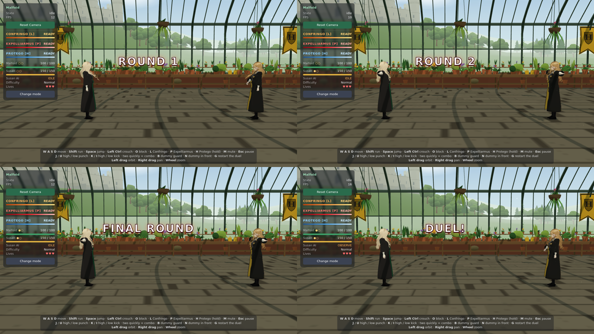
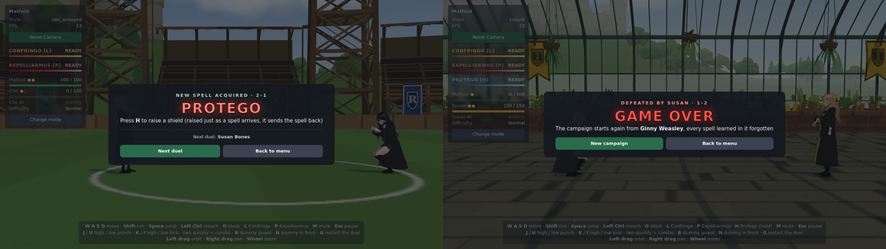
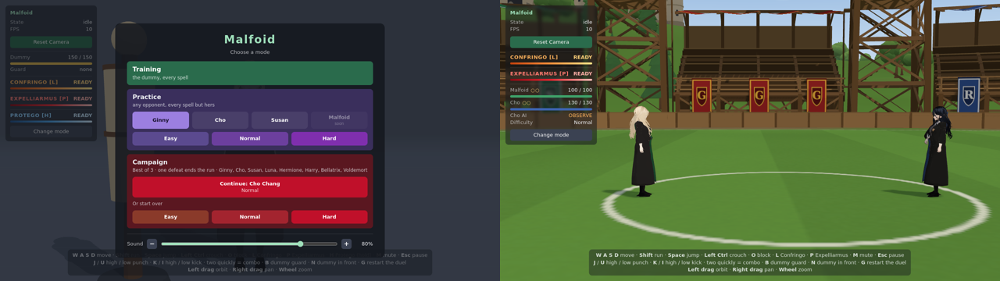

# Best-of-three campaign duels, no lives

Each campaign duel is now a **match**: best of three rounds, and the first to two round wins
takes it. The campaign has **no lives**: lose a match and it's game over, so the run starts again
from Ginny with every learned spell forgotten. Practice stays a single fight.

| Rounds (Malfoid's result) | Match |
|---|---|
| win, win | victory 2–0 |
| win, lose, win | victory 2–1 |
| lose, win, win | victory 2–1 |
| lose, lose | defeat 0–2: game over |
| lose, win, lose | defeat 1–2: game over |
| win, lose, lose | defeat 1–2: game over |

## How a match runs

1. **Round 1:** the opening lines (as before), then **ROUND 1** holds for 1.3 s with both
   fighters still, then **DUEL!**.
2. **A round won short of the match:** the banner names the winner (**SUSAN WINS ROUND 1**) and
   her pip fills in by her name on the HUD.
   - After 3 s the screen dips to dark (0.35 s).
   - Behind it both fighters are reset, in the same arena against the same opponent: full health,
     wands back in hand, every spell, Protego and Episkey cooldown cleared, healing charges
     refilled, any slow lifted, and back on their start marks.
   - Each fighter snaps straight into her stance, with no rising out of a knockout.
3. **The next round:** the screen fades back in on **ROUND 2**, or **FINAL ROUND** at one round
   each. It holds 1.3 s with the controls locked and the AI off, then **DUEL!**.
4. **The match decided:** the winner's banner, her voice line, then the result.
   - The campaign's result (a spell learned, or game over) comes only now, never after a single
     round.
   - No voice lines play between rounds, and the arena is never rebuilt.

**The result screen** shows the score in rounds:

- a win: **NEW SPELL ACQUIRED · 2–1**, or **VICTORY · 2–0**;
- a loss: **DEFEATED BY SUSAN · 1–2 / GAME OVER**, with **New campaign** (same difficulty) or
  **Back to menu**.

- **Menu:** the campaign box reads "Best of 3 · one defeat ends the run". Continue shows only the
  next opponent and the difficulty.
- **HUD:** the Lives row is gone; each name carries its round pips (● ○).
- **Saved runs:** a run saved while the campaign had lives still continues; its lives are
  dropped.

## Code

- `src/game/match.ts`: `Match` holds the round wins, `round`, `final`, `decided` and
  `record(malfoidWon)`. `MATCH = { bestOf: 3, toWin: 2 }`.
- `src/game/campaign.ts`: there are no lives. `lose()` ends the run.
- `src/main.ts`: `finish()` records the round. Short of a decision, it starts the round break.
  - `setDuel(true)` resets the fighters for the next round (the same reset as a fresh duel).
  - `announceRound()` puts up the title, and the loop counts `roundIntro` down to `startFight()`.
  - Tunables (s): `ROUND_BREAK` 3.0, `ROUND_FADE` 0.35, `ROUND_INTRO` 1.3.
- `AnimationController.snap` and `Malfoid.snapToStance()`: straight into the stance, with no
  blend from the pose before.
- `CombatHud.setRounds`, and the `#round-fade` overlay. The overlay sits over the scene and
  under the HUD and the menus.

## Validation

Headless Chromium (SwiftShader), real game, rounds ended by real hits:

| Check | Result |
|---|---|
| Ginny win–lose–win | 2–1, Expelliarmus learned, run saved at Cho |
| Cho win–lose–win (an old save with lives, continued) | 2–1, Protego learned, lives dropped from the save |
| Susan lose–win–lose | **game over** 1–2, saved run cleared; **New campaign** → Ginny, Confringo only |
| Ginny lose–lose | **game over** 0–2; the menu no longer offers to continue |
| Earlier rules run: lose–win–win, win–win | 2–1 and 2–0 victories |
| Reset between rounds (both disarmed, Protego 5 s, Susan's spell 5.8 s, Episkey 1/2 charges and 5.7 s) | wands in hand, every cooldown 0, Episkey 2/2, full HP, start marks |
| During ROUND 2 / FINAL ROUND | controls locked, AI off; then DUEL! and both act |
| Campaign events per match | one `campaign.win`/`lose` and one win line, only at the decision |
| Arena switches between rounds | none |
| Pause during the round break | the break waits; resuming carries on to ROUND 2 |
| Practice | one fight, no round pips, no voice lines (unchanged) |
| GPU over 10 rounds at Susan's (both casting each round) | flat at 99 / 41 / 41 (geometries / textures / programs) from round 3 on; 123 draw calls |
| `npm test`, 8 combos, Confringo checks | 90 / 90, 8 / 8, all pass |

## Also in this branch

- **Sound files:** Susan's spells have their own sounds, added as `public/sfx/impedimenta.mp3`
  and `public/sfx/episkey.mp3`.
  - **Impedimenta:** a soft swell from the cast's start. It peaks just after the bolt leaves; a
    cancelled cast cuts it.
  - **Episkey:** a bright, holy swell the moment she heals. The file is ~9 dB quieter, hence a
    2.5× gain.

## Known limitations

- **Leaving mid-match:** leaving through the menu restarts the match from round 1 when you
  continue. As before, leaving costs nothing; it could be used to escape a lost round.
- **Impedimenta's burst:** in one frozen frame, its fireball showed as a near-white dome for its
  first frame. In motion it lasts about 0.1 s and turns pale blue. It isn't part of this change.
- **Untested:** real-GPU frame rate and real-time feel. Everything ran headless, in slow motion.
