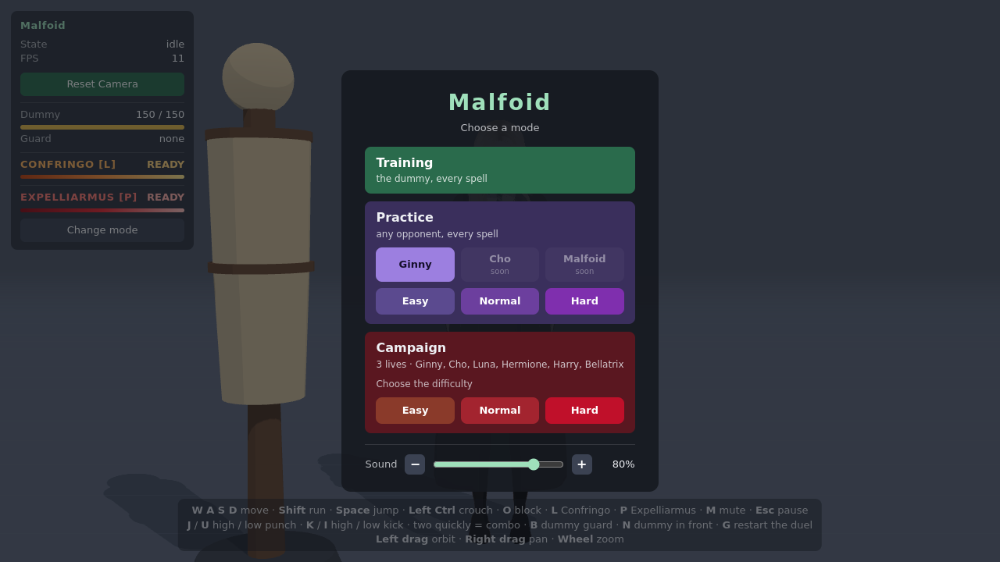
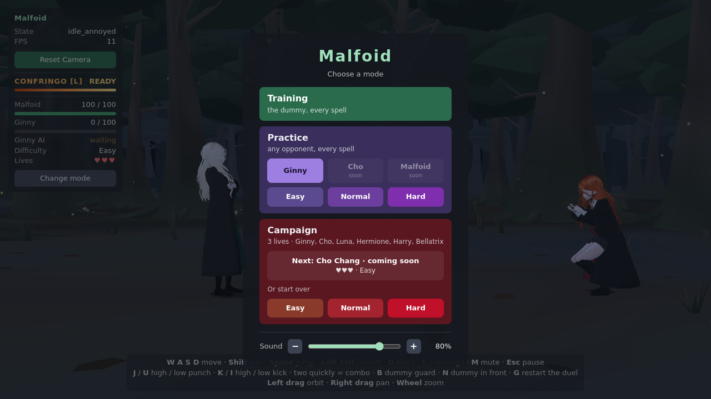
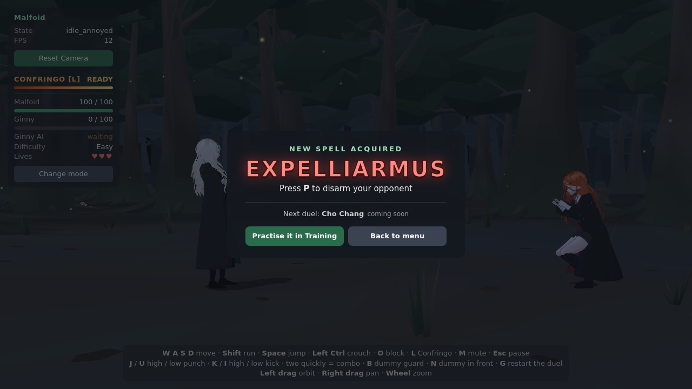
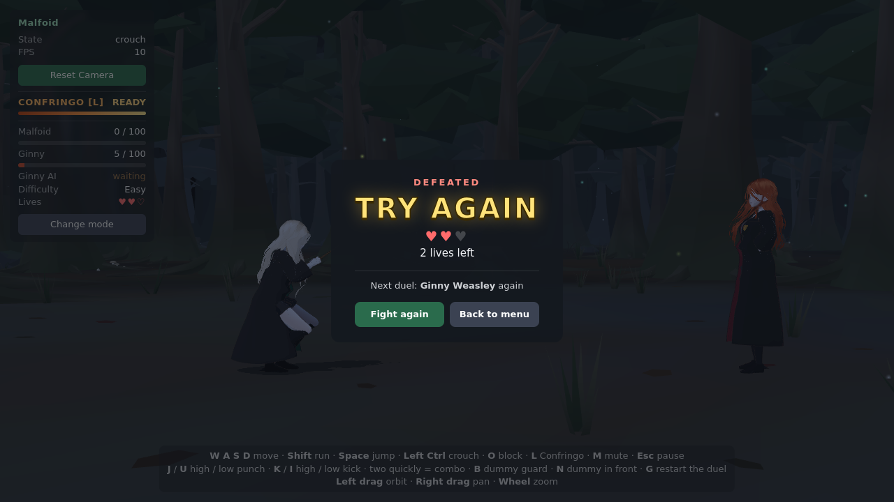
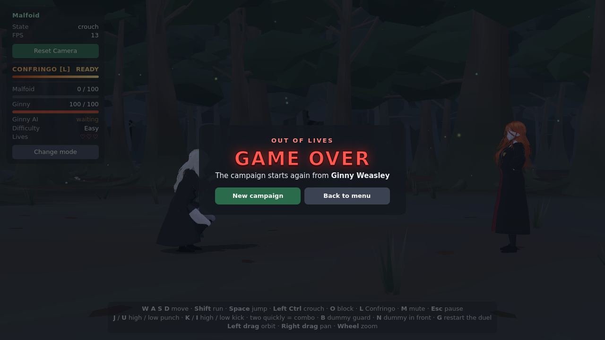
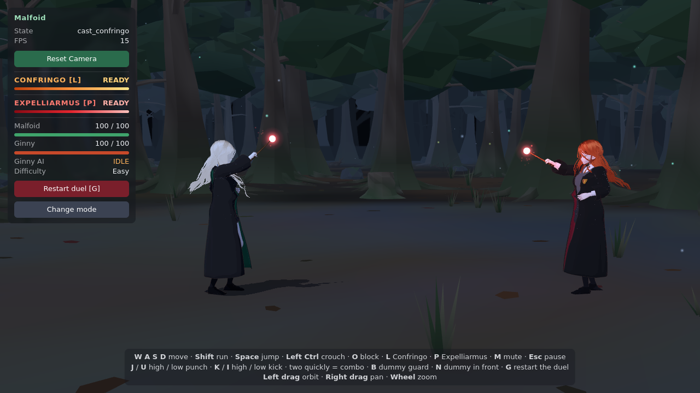
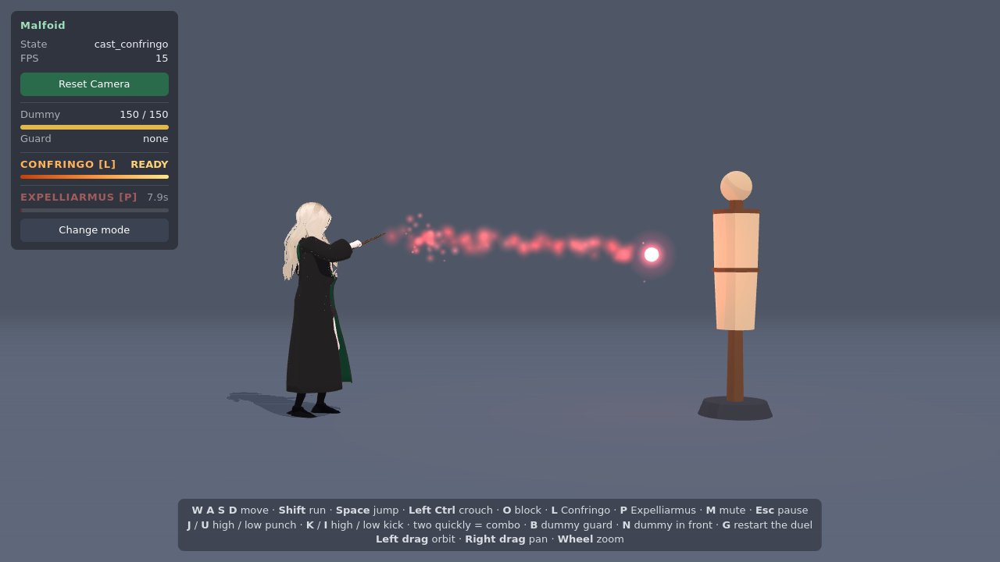
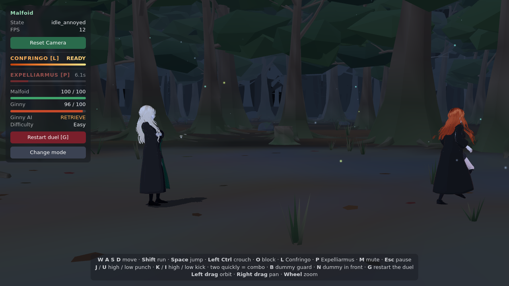

# Modes, the campaign and Expelliarmus

Three modes replace Training / Duel, and Malfoid learns her first spell from an opponent.

| Mode | Where | Opponent | Spells | Opening lines | Restart (G) |
|---|---|---|---|---|---|
| Training | studio | the dummy | every spell | – | – |
| Practice | Forbidden Woods | picked (Ginny now; Cho and a Malfoid mirror match listed as coming soon) | every spell | no | yes |
| Campaign | Forbidden Woods | in order: Ginny, Cho, Luna, Hermione, Harry, Bellatrix | Confringo + those learned in this run | yes | no |

## The campaign

- The difficulty is chosen once, when a run starts, and holds for the whole run.
- **3 lives** for the run. A loss costs one and the same opponent is fought again; at 0 it is
  game over and a new run starts from Ginny with the spells forgotten.
- A win teaches Malfoid the opponent's spell (Ginny: Expelliarmus) and the next opponent is up.
  Cho isn't built yet, so after Ginny the run waits at "Next: Cho Chang · coming soon".
- The run (difficulty, lives, stage, spells learned) is saved in `localStorage`
  (`malfoid.campaign`), read defensively (anything malformed is no run). Starting a new run
  while one is in progress takes a second click.
- The result screen comes after the winner's line; Esc doesn't close it.

| | |
|---|---|
|  |  |
|  |  |

## Expelliarmus for Malfoid (P)

The same spell as Ginny's (4 damage, stagger, disarm, 8 s cooldown, its own HUD slot), cast
with the Confringo wand clip. Not available against Ginny in the campaign.

- **Effects:** one effect pool per look, shared by every caster of that spell (Malfoid's
  Expelliarmus uses Ginny's red pool), so no extra point lights. The pool now has a charge
  orb per caster, so both can wind up at once (`SpellFxSet` routes a caster's spells to their
  pools; exactly one set advances each pool).
- **Ginny disarmed:** her AI has a new `RETRIEVE` state: once her wand has landed she runs to
  it (walking onto it picks it up) and then fights on.

| | |
|---|---|
|  |  |
|  | |

## Validation (headless Chromium, SwiftShader)

| Check | Result |
|---|---|
| `npm test` | 50 / 50 (campaign: order, lives, game over, saved run, malformed data; AI wand retrieve; spell sounds) |
| Training / practice: every spell; campaign before Ginny: P does nothing, its slot and help hidden | ✓ |
| Practice: no opening lines, AI active at once, G restarts | ✓ |
| Campaign: opening lines, G ignored, lives 3 → 2 → 1 → game over, stored run cleared | ✓ |
| Win: Expelliarmus learned, stage 1 (Cho), menu shows Cho coming soon, survives a reload | ✓ |
| P on the dummy: 4 damage, 8 s cooldown separate from Confringo's | ✓ |
| Ginny disarmed in practice: OBSERVE → STAGGER → RECOVER → RETRIEVE → wand back | ✓ |
| Both casting Expelliarmus at once: two charge orbs | ✓ |
| All 8 combos chain with the expected damage | 8 / 8 |
| Confringo: direct hit 20, holding L casts once, cooldown frozen while paused, a miss ends at 25 m, effects clean up | ✓ |
| GPU (geometries / textures / programs) over 7 rounds of P + L with disarms | 100 / 34 / 37 every round |

Not checkable here: the real frame rate, and how the sounds land by ear.
