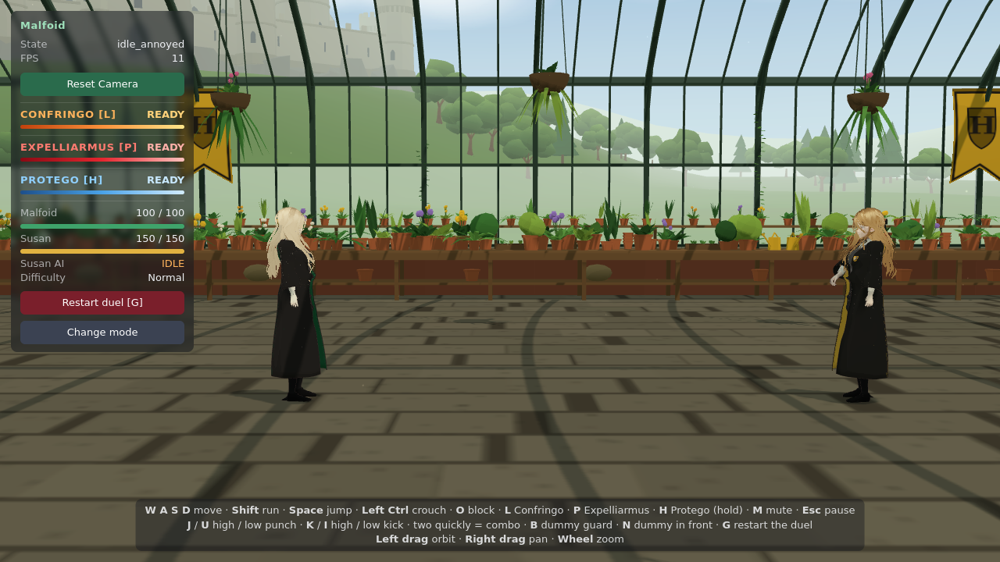
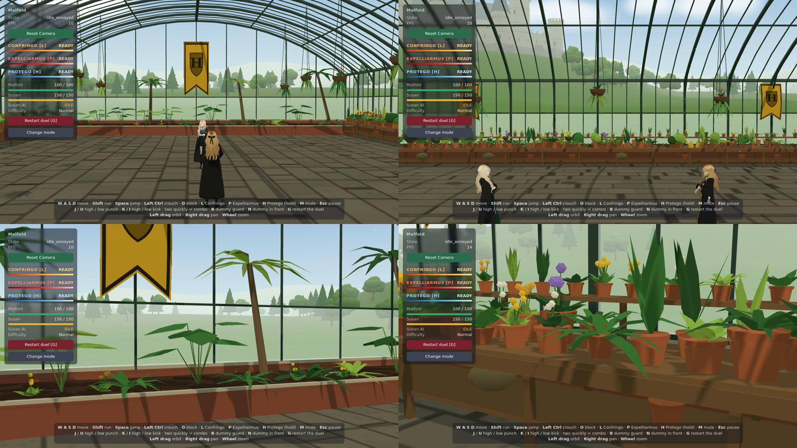
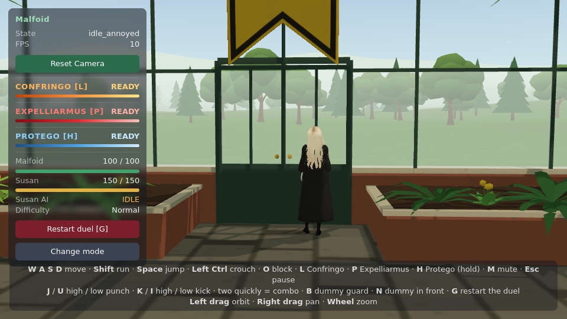
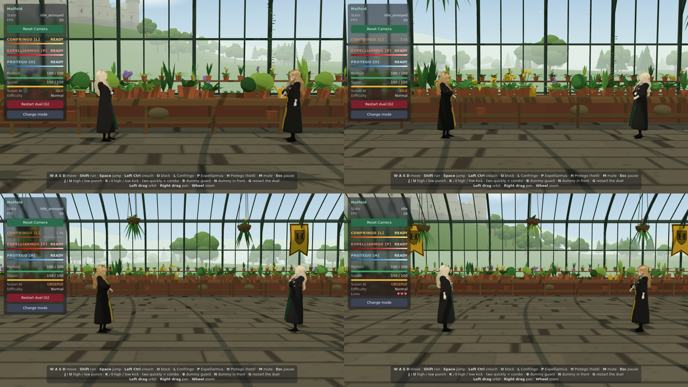
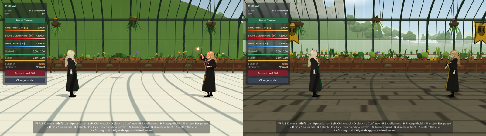

# Herbology Greenhouse — Susan's arena

Susan fights in a Victorian glasshouse built in code, the way the pitch is: no model files, no
premade assets. Every screenshot here is from the real Three.js viewer (headless Chromium,
SwiftShader).

The duel camera's view. Behind the fighters:

- the far potting bench and its staging;
- the frosted lower panes, a light, calm band behind the fighters;
- two Hufflepuff banners high on the wall, above the fighters' heads;
- the grounds and the castle through the clear glass.

## What it is

- **House:** 32 × 20 m inside.
  - A brick plinth with a stone coping.
  - Iron-framed glass walls (posts every 2 m, three glazing bars per bay, a transom rail).
  - A segmental barrel vault: 3.8 m eaves, 7.4 m crown, ribs over every post, purlins, and ridge
    cresting with finials.
  - The east gable has a doorway with two closed glazed doors (panelled below, brass handles).
    At first the doors stood half open, and the east planter ran across in front of them.
- **Glass:** up to the transom the panes are frosted. They read as glass, and they give the
  fighters a calm backdrop. The upper panes and the roof are nearly clear.
- **Floor:** stone flags in running courses, with moss and damp patches, in a generated texture.
- **Benches:** potting benches along both long walls, each with a raised back shelf (staging).
  - **Plants** in terracotta pots: leaf rosettes, ferns, upright strap-leaved plants, flowering
    plants (most often Hufflepuff yellow) and clipped bushes.
  - **On top:** seedling trays, yellow watering cans and stacks of empty pots.
  - **Underneath:** big pots and compost sacks.
- **Ends:** raised brick planters, with palms at the back and broad-leaved plants, ferns and
  flowers in front. The east planter is two beds, with a flagstone path (2.6 m wide) between them
  to the door. No palms stand within 2.2 m of the path: from the duel camera in the corner, one
  there hid a fighter on the path.

  
- **Overhead:** twelve hanging baskets under the vault.
- **Walls:** ivy up every third wall post, a Hufflepuff banner on each gable and two along each
  long wall. The banners reuse the pitch's cloth.
- **Outside:** the pitch's landscape code, with lower hills (14 m) and the castle moved to 330 m
  so its hill sits behind the house, not against it. A lawn and a gravel path surround the
  house.
- **Light:** warm daylight and a humid haze. Only the main iron frame casts the sun's shadow (the
  ribs' curved bands across the floor). The thin glazing bars don't, or the floor would be
  striped all over.
- **Motes:** 220 points of pollen and dust drift slowly in the light, the only thing that moves.

### Gameplay

- **Fighters:** they stay on the stone floor between the bench fronts and the planters
  (|x| ≤ 13.35 m, |z| ≤ 8.45 m), and up the path to the door (to x 15.55 m, |z| ≤ 0.85 m).
- **Spells:** they burst on the bench plants (up to 1.8 m) and the planters. Beyond those, the
  glass walls are solid too.
- **Camera:** it stays on the floor too, never behind the plants. Near a bench it watches from
  the open side.

## How it was checked

The tiles: fighters at the far bench (the bench reads as background, not clutter); both fighters
near the +z bench, with the camera watching from the open side; Susan's AI fighting; the
campaign's stage 3, which starts here.

| Check | Result |
|---|---|
| A fighter placed past each bench and planter | back on the floor in a frame (x ±13.07, z ±8.17: the bound less her radius) |
| Confringo at the far bench, then at the west planter | bursts on the plants (z −8.7) and on the planter (x −13.6) |
| Duel camera with both fighters at the +z bench | flips to the open side (camera at z −0.16 looking at them) |
| GPU across practice Cho → Ginny → Susan → Cho → Susan → training | flat once every arena has been shown: 206 / 76 / 55 (geometries / textures / programs) |
| Cost against the pitch (duel view, headless) | 113 draw calls and 690k triangles (pitch: 106, 715k; shadow pass included); built in 257 ms (pitch: 262 ms) |
| Campaign stage 3, practice | Susan's duel starts in the greenhouse; Cho's on the pitch; Ginny's in the woods |
| `npm test`, 8 combos, Confringo checks | 81 / 81; 8 / 8; all pass |

**Fixed along the way:**

The first version (left) had:

- **A white floor:** the flagstone colours used a 32-bit hash where a 0–1 value was meant.
- **A green wall outside:** the pitch's hills and the castle's plateau stood right outside the
  glass.
- **A striped floor:** every glazing bar cast a shadow.
- **Glass that didn't read:** it was simply missing visually.
- **Sparse benches.**

## Tunables

All of them are in `src/scene/greenhouse/config.ts`:

- size, vault and frame;
- glass tints and opacities;
- floor colours;
- bench, staging and planter sizes;
- pot spacing, greens and flower colours;
- the number of banners and baskets;
- the motes;
- the grounds (castle bearing and distance, hill height, trees);
- light, haze and the shadow area.

## Known limitations

- **Low-poly plants:** they are simple shapes (folded leaf quads, icosahedron bushes), with no
  wind or sway.
- **Planters:** the end planters are sparser than the benches.
- **Glass:** no reflections or highlights; it reads through its tint and the frosted band.
- **Shadows:** the rib shadows lie over the fighters as well as the floor.
- **Headless only:** the real GPU frame rate is untested. The triangle count matches the
  pitch's, which mostly comes from the shared landscape.
