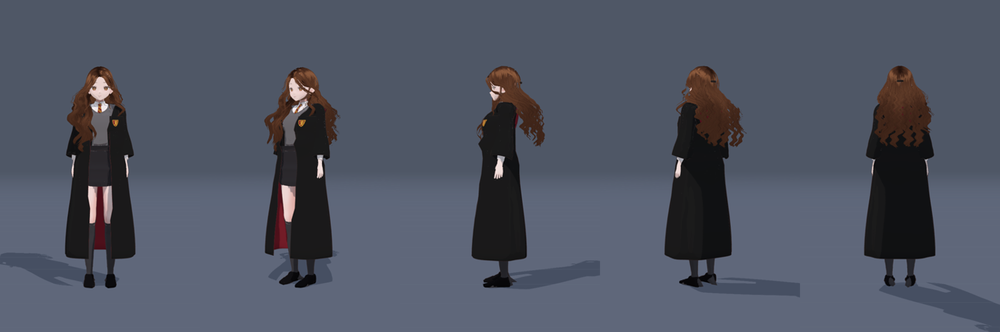
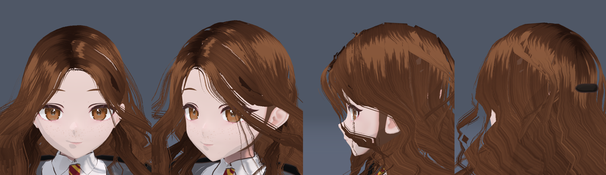
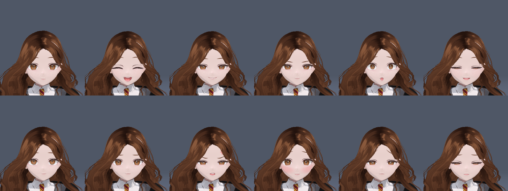
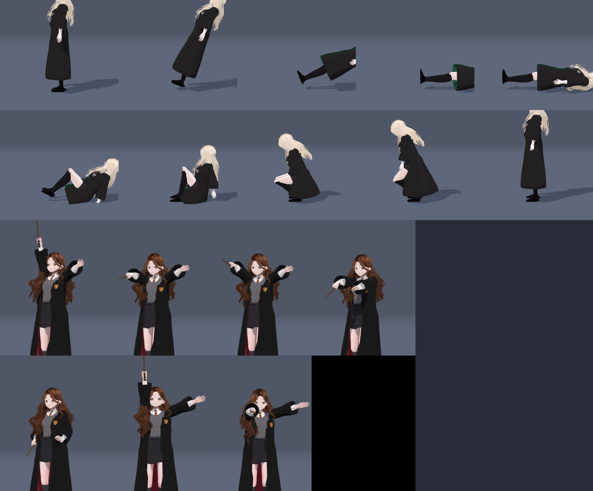
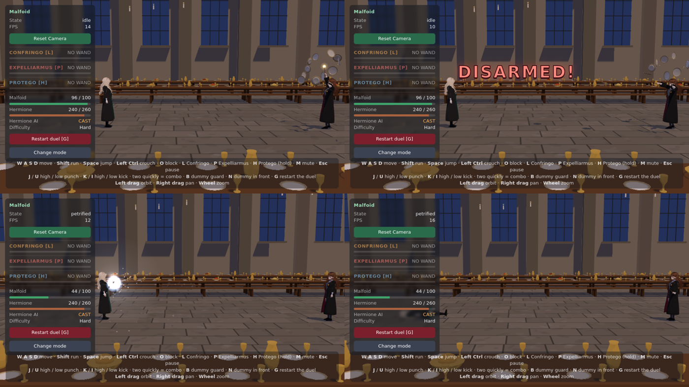
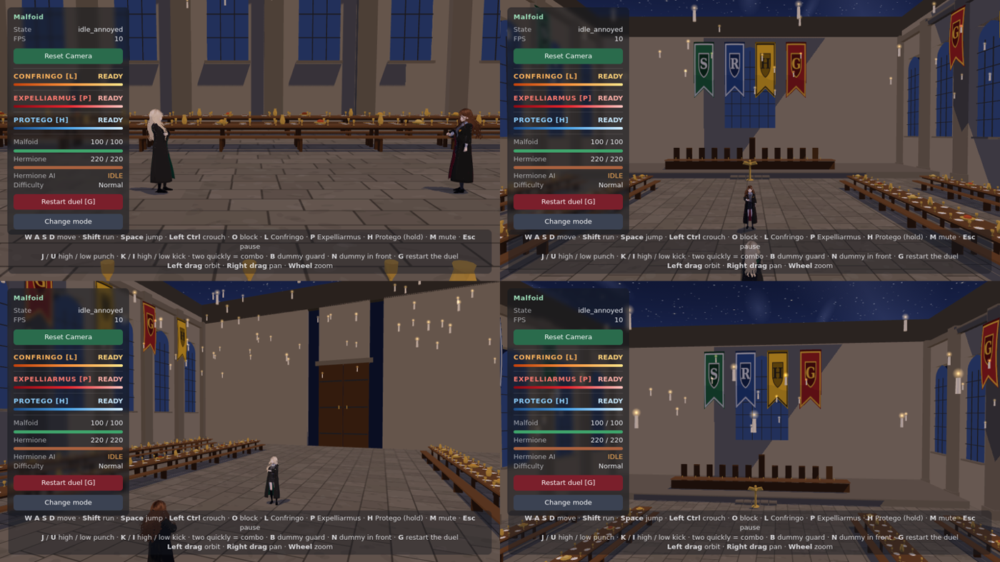

# Hermione Granger — implementation and validation report

Hermione is the fifth opponent and the hardest student: a precise, tactical duellist who uses the
Great Hall's dinner plates as weapons ([design](DESIGN.md)). She uses the same purchased assets and
pipeline as the others. Every screenshot here is from the real Three.js viewer (headless Chromium,
SwiftShader), not a Blender render. Her character and facial atlases stay local (`/Hermione/` in
`.gitignore`).

## Build

- `make hermione` (`MF_CHAR=hermione`) builds `build/hermione.blend` and
  `public/models/hermione.glb` + `.json`. Her values are in her profile in
  `tools/blender/malfoid/character.py`.
- **The others are untouched:** after the pipeline changes, Ginny, Cho, Susan and Luna rebuilt
  **byte-identical**. Malfoid's model changed only by two added clips (`petrified`, `get_up`):
  her other 29 clips are identical.
- **Robe check** (`tools/qa/robe_folds.py`, which now knows her and the new clips): **0 % folded
  area and 0 crossed vertices** for every clip of Hermione and of Malfoid.

## Appearance

- **Hair:** long, very full, curly chestnut hair (#6B4A3A), half-up, with a dark clip at the back.
  There is only one purchased hair mesh, so the volume and curls are reshaped cards, not props:
  - `assets.volumize` widens the hair to the sides and fills it out behind, below the brow line.
  - `assets.curl_hair` makes each card spiral as it falls, with its own phase and wavelength.
  - `ribbon.build_clip` builds the barrette.
- **Fixes from the first passes:**
  - The hair first read caramel-orange (the toon light lifts it about 1.5×), and the eyes a
    bright amber.
  - Scaled forwards, the volume carried the face-framing locks across the cheek in profile; it now
    only goes to the sides and back.
  - Curled, those locks turned edge-on into zig-zag lines; they now only wave.
- **Face:** brown eyes, light freckles across the nose and cheeks, a composed resting face with a
  faint, self-assured smile.
- **Uniform:** Gryffindor maroon and gold, grey vest, dark grey knee socks, the Gryffindor crest.

## Expressions

`HERMIONE_FACES` in `src/character/faces.ts`, from her atlas. From top left:
- neutral, cheerful, confident (smug), determined, surprised, amused;
- thinking, frustrated, angry, embarrassed, sad, pain.

Her brows hide under her hair, so determined and angry are carried by the eyes and mouth (the
first passes read near neutral). Her opening exchange is six lines, three each, she first, each
setting its speaker's face (`HERMIONE_LINES` in `src/audio/duelVoices.ts`).

## Animation

Top: Malfoid's new clips, from the side. Bottom: Hermione's.

| Clip | Whose | What it does |
|---|---|---|
| `petrified` | Malfoid | The bind snaps her rigid (arms at her sides, legs together). She topples backwards about her heels like a plank, slowly then fast, lands flat with a small bounce, and stays down. |
| `get_up` | Malfoid | She sits up on her hands, draws her feet in, rocks forward into a crouch and stands. It's authored from a root 0.55 m further back, and the game moves her root there as it starts, so nothing jumps. |
| `hermione_idle` | Hermione | Upright and alert, the wand held ready across her front. |
| `cast_plates` | Hermione | The wand high and the left hand out over the rising plates (the wind-up, to 1.1 s), then the wand conducting them at the target. |
| `cast_accio` | Hermione | The wand at the wand on the floor, the left hand reaching, then closing on the catch. |

She also has Cho's `cast_quick` (Petrificus), the side-step, the dodges and the `protego` pose.
(A push spell, Ventus and then Depulso, was added and removed on request; her model is back to
these 37 clips.)

**Fixes from the first passes:**
- the plates' raised left hand read as a wave;
- the conducting forearm crossed her face;
- Accio's reach covered it.

## Her kit

Hard, her real AI, frozen at each moment. From top left:
- the plates rising off the tables into the fan round her;
- the barrage in flight at a Malfoid she has just disarmed (no wand, no Protego: the plates took
  her from 96 to 44);
- Malfoid bound by Petrificus;
- Malfoid lying bound with her wand in Hermione's hand. Only Malfoid's legs show clear of the HUD
  panel: see Known limitations.

| | Effect | Tuning |
|---|---|---|
| **Plate Barrage** | **Wind-up:** about a second. 8 / 10 / 12 plates rise off the nearest places on the tables into a fan round her. Hit her then and they all drop and shatter. **Launch:** one every 0.13 s, straight at 15 m/s, aimed where Malfoid will be. **Damage:** 3 / 3 / 4 each, with a flinch. **Defence:** a guard takes chip damage; Protego stops plates while it lasts (0.9 s, not a whole volley); a perfect Protego reflects one plate per volley. | `spells/Plates.ts`; cooldown 15 / 12 / 10 s |
| **Her aim** | She leads Malfoid's smoothed velocity (60 / 85 / 100 % of the predicted lead). While plates fly, each quick dodge across her line teaches her Malfoid's habit, and she aims up to 0.3 / 0.5 / 0.7 m further that way. | `FighterAI.aimAt` |
| **Petrificus Totalus** | A pale blue bolt: 4 damage. It binds Malfoid for 1.7 / 2.0 / 2.2 s, then she gets up. While she's down or getting up, only one more hit lands. A guard or Protego stops it. | `spells/Petrificus.ts`; cooldown 15 / 12 / 9 s |
| **Expelliarmus + Accio** | She disarms into Malfoid's casts, then turns to the dropped wand and summons it into her left hand (ACCIO!). A hit that gets through makes her let go. Accio can be interrupted and has a 10 s cooldown. | `spells/Accio.ts`, `Wand.summon` / `loose` |
| **Protego** | Often timed to reflect. | `Protego.ts` |

## Her AI (the prodigy style)

`FighterAI` gains a `prodigy` style. Her reactions keep human timing (no input reading); her edge
is her choices.

- **Reading:** she reads every cast (Protego, parries), disarms into casts, and chains Petrificus
  onto a spell her shield stopped.
- **Petrificus:** she casts it at an opening: Malfoid reeling, just after her cast, her Protego
  cooling down, or sprinting about.
- **After a bind:** one follow-up, either Expelliarmus at once or the plates, timed so the
  first one flies as Malfoid is back on her feet.
- **Wand theft:** Accio at a dropped wand, turning to it first.
- **Plates:** at range only (3.5–12 m), never with Malfoid close enough to interrupt the wind-up,
  and more often while her Protego cools down.
- **Distance:** she keeps a caster's distance, circling. Holding Malfoid's wand, she lets her come
  within 2.5 m. Crowded, she walks back. Her quick back-step was removed on request: chained, it
  slid her away too fast. She still side-steps an attack she sees coming.

**Fixes from the playtests:**
- At first she kited with the stolen wand and kept binding a wandless Malfoid, a death
  spiral that every level won in 35 s. The fix: a wandless Malfoid isn't an opening by itself,
  she lets her come close, and only one follow-up after a bind.
- Her Accio never fired in the game: the idle state turned her back to Malfoid every frame. She
  now holds her facing on the wand.

## Arena: the Great Hall

A long stone hall at night, generated in code (`src/scene/greathall/`):
- **Size:** 44 × 30 m.
- **The tables:** the four house tables and benches, set with about 280 plates (instanced), goblets,
  jugs and dishes.
- **The ends:** the staff's high table on its dais, with the golden owl lectern; the entrance
  doors at the other end.
- **The walls:** tall pointed windows and house banners, each wall alternating its two houses,
  with the four houses behind the high table.
- **Overhead:** 140 floating candles and the enchanted night-sky ceiling.

How it plays:
- **The central aisle:** about 11 m clear between the benches. It was widened on request: at
  6.7 m there wasn't room to fight.
- **Walking:** the fighters walk the whole floor round the tables, benches and dais, so a dropped
  wand is always reachable.
- **Spells:** they fly over the tables and burst on walls, benches, dais and high table.
- **Ammunition:** her barrage takes the nearest plates off the tables; every plate is back for each
  duel or round.
- **Camera:**
  - Outside the central aisle it stays at least 1.9 m up, so the fighters' feet show past the
    tables.
  - Right over a table it stays at least 2.8 m up, so its plates and goblets don't fill the
    frame. It rises smoothly as it crosses one.
  - **Fixed after a report:** with a fighter between the side tables, it ended up looking
    straight down from 10–16 m, or sitting on a table. It used to be kept out of the strips over
    the tables, which left it nowhere to stand, and each frame's minimum-height lift was kept,
    steepening the view for good. The lift now holds for one frame. In a live fight with Malfoid
    between the tables, the camera stayed at most 1.9 m up and 4° down, at least 9.6 m away.
  - **Still:** Malfoid lying in a side aisle (Petrificus) is hidden behind the table between
    them. A low camera can't see over it; that would take a steep view from about 7 m up.

**Cost:** 95 draw calls and 459k triangles in the duel view, both fighters included.

## Camera changes (shared with every arena)

- **The HUD panel:** the duel framing now follows the panel's real width. At long range in a
  small window, Malfoid stood under the panel. Each fighter is now framed at her own
  depth: off side-on, the nearer one shows further out, and with one between the tables she stood
  half under the panel.
- **Turning less (on request):** the camera holds still until the fighters' line is about 30° off
  side-on, then turns at 1.5 rad/s (was 2.2). In the hall it also swung round to the other side,
  because its side check counted the spots over the tables as no room; it now checks only the
  walls. Over a 37 s fight it turned 85° per minute and never flipped.

## Validation

| Check | Result |
|---|---|
| `npm test` | 137/137 at the end of the branch. New: `tests/stunlock.test.ts`, `tests/evade.test.ts`, `tests/camera.test.ts`, and `tests/hermione.test.ts` (16 tests: the barrage, straight flight, the interrupt, one reflect per volley, walls, the bind and its one follow-up hit, lying hurt volume, Accio, her definition and levels, her AI's choices, the follow-up timing, the aim's lead and learned habit, no quick back-step) |
| Mechanics in the game | All 10 plates hit a still target (4 each, before damage was set per level). Petrificus bound Malfoid, who stood up 0.55 m back. Accio stole the dropped wand, and a hit made Hermione drop it. |
| Jump while bound | four real Space presses: she stays down (state `petrified`) |
| GPU across repeated barrage, bind and theft cycles | flat at 95 / 40 / 43 (geometries / textures / programs) |
| Combos, Confringo checks | 8/8, all pass |
| Ginny, Cho, Susan, Luna GLB | byte-identical; Malfoid: clips added only |

### Playtests

A scripted Malfoid against Hermione's real AI in the Great Hall. The bot:
- casts Confringo;
- raises Protego when it reads her casts, the plates included;
- guards against bolts half the time;
- sprints in to close the distance.

| Level | Winner | Hermione's HP left | Time | Hermione's casts |
|---|---|---|---|---|
| Easy | Hermione | 57 / 170 | 45 s | Petrificus 1, Expelliarmus 1, plates 2 |
| Normal | Hermione | 70 / 220 | 53 s | Petrificus 1, Expelliarmus 1, Accio 1 (the bot won its wand back in 6 s) |
| Hard | Hermione | 184 / 260 | 40 s | Petrificus 2 (both guarded), Expelliarmus 2 |

What the numbers say:
- **She is the hardest so far:** the same kind of bot beat Luna at Normal.
- **Easy is close,** and the bot ran her down to a quarter of her health.
- **The bot is a poor stand-in:** it presses into melee all fight. That left her no room for the
  plates at Normal and Hard, so these runs mostly measure close-quarters play. It also never dodges
  a plate on purpose or keeps its distance. A player who keeps to mid range, guards the plates and
  times Protego will see her full kit. Real-time feel is untested.

## Known limitations

- **Her reward:** Petrificus Totalus for Malfoid isn't built yet (like Susan's Episkey and Luna's
  Illusio).
- **The plates' sounds** borrow Ventus's whoosh, and plates shattering have no sound of their own.
- **Lying, Malfoid's body extends behind her feet.** In a small window her upper body can sit under
  the HUD panel; the framing keeps her feet clear, not her whole lying body.
- **The skirt:** from her feet's direction, the lying pose shows under it. The duel camera views
  her side-on.
- **Untested:** real-GPU frame rate and real-time balance against a human; everything ran headless.
