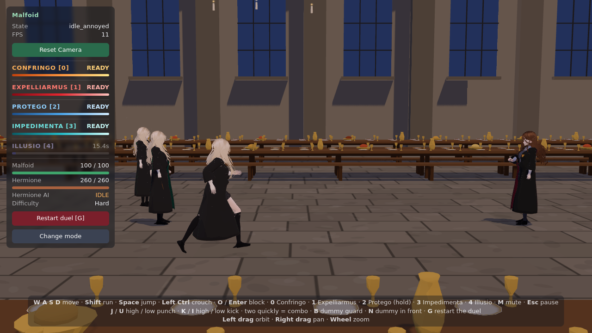
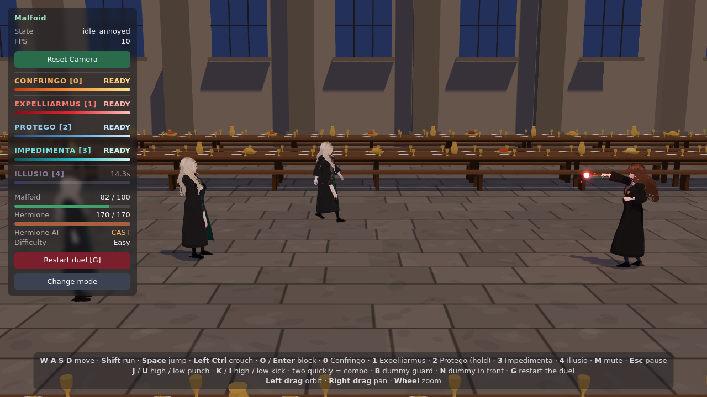
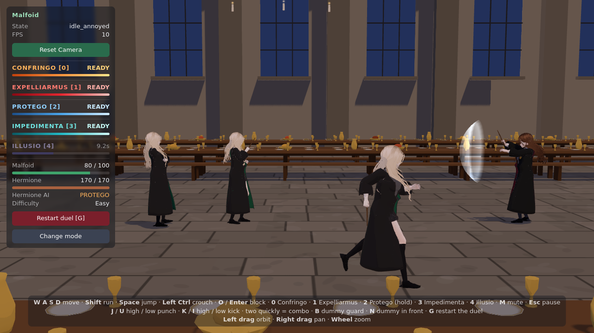
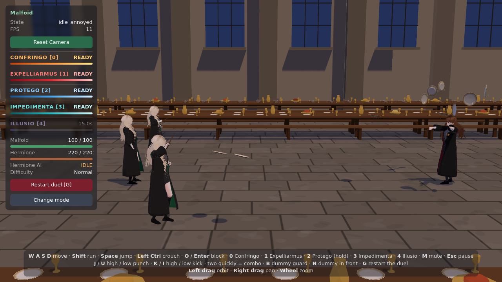

# Malfoid's Illusio — implementation and validation report

Malfoid learns Luna's Illusio by beating her in the campaign (key 4). She uses it to fool her
opponent's AI, above all Hermione's. It was built in four steps, on request:

1. the copies;
2. the opponent's belief, and seeing through it;
3. baiting her Protego;
4. where her plates go (measured; kept as it is, on request).

Every screenshot here is from the real Three.js viewer (headless Chromium, SwiftShader).

## 1. The copies

*Hermione, Hard, just after key 4: the real Malfoid is the middle figure with a shadow; a copy
skips off in front, the other stands behind.*

- **The cast:** her wand circles overhead and her arms sweep open, using Luna's `cast_illusio`
  clip, added to Malfoid's model. Two copies appear beside her for **8 s**, and the spell has a
  **16 s** cooldown.
- **No shuffle:** unlike Luna, Malfoid stays where she is, because the player steers her.
- **How they move:** the copies face and circle her opponent (the training dummy in training), more
  calmly than Luna's.
- **The tells:** they mimic her casts a beat late, with no bolt, and they cast no shadow.
- **Popping:** any hit, or the opponent walking into one, pops a copy. A hit on Malfoid makes
  them all vanish.
- **The code:** it reuses Luna's `Illusions`, which now has a settable foe, a shuffle switch, its
  own movement chances and feints, plus `Malfoid.makeTwin`.
- **The opponent's attacks:** the copies are among her targets, so a strike, bolt or plate that
  meets one pops it. Her aim never picks a copy on its own (`SpellSystem.aimAtIllusions`); only her
  AI's belief does.
- **Malfoid's model:** rebuilt with `cast_illusio`. Her other 31 clips are byte-identical, and
  the robe check reports 0 folded area for every clip.
- **Cost:** two copies add about 70 draw calls while they show, the same per copy as Luna's. GPU
  resources stayed flat over repeated casts.

## 2. Belief, and seeing through it

*Easy: Hermione's Expelliarmus charges at the copy in the middle. The real Malfoid, with a shadow,
is on the left.*

- **Belief:** as the copies appear, her AI may take one for Malfoid (`FighterAI.believed`). Every
  position she reads then goes through that figure: distance, angle, line of sight, aim, tracking
  and roaming.
- **Her spells:** they go where she means them (`SpellSystem.intended`), and her plates strike copies
  (`PlateBarrage.extraTargets`).
- **Picking again:** when the copy she watched pops, she picks again among the figures left.
- **Seeing through it:** in time, or at once when the real Malfoid's bolt flies or she strikes
  within reach. After that she keeps to the real one until the copies are gone.

| | Spots the real one at once | Sees through a copy after |
|---|---|---|
| Hermione, Easy | 15 % | 2.6–3.4 s |
| Hermione, Normal | 25 % | 1.8–2.4 s |
| Hermione, Hard | 35 % | 1.1–1.5 s |
| Anyone else (default) | 15 % | 2.5–3.5 s |

**Measured:**
- **Her first pick, over 12 casts:** fooled 6 times on Easy (57 % expected) and 3 times on Hard
  (43 % expected).
- **Live, on Easy:**
  1. She took copy 0 for Malfoid and cast Expelliarmus at it, which popped it.
  2. She took copy 1 for Malfoid.
  3. She saw through it at 3.3 s and cast Petrificus at the real one.
- **Live, on Hard:** she saw through at 1.4 s, before her barrage flew.

## 3. Baiting her Protego

*Staged (her belief forced, the rest real): her Protego is up at the feint of the copy in the
middle, while the real Malfoid, on the left, isn't casting.*

- **What she reads:** while she watches a copy, she reads that copy's casts in place of the real
  ones: its mimicry, or a **feint** of its own. Malfoid's copies feint the first time 0.4–1.2 s after
  appearing, then every 2–3.5 s; Luna's never feint.
- **The cost to her:** she may raise Protego (or dodge) at a bolt that never comes, and her shield
  then needs 5 s before it can go up again.
- **The real cast:** it goes unread meanwhile, until its bolt flies.

**Measured on Hard:** her real AI, against a scripted Malfoid who casts Illusio, then Confringo
the moment Hermione's shield goes up at nothing.
- **How often she was baited:** in 4 of 10 Illusio windows. With the first feint later, at first
  she was baited in only 1 of 8, because she saw through before it.
- **After a bait:** Confringo hit 3 times out of 4; the 4th missed as she moved.
- **Without Illusio:** Confringo hit 4 times out of 10. None was shielded, but 4 missed on walls or
  at range, so the gain can't be put as one number from this sample.

## 4. Her plates

*Normal: plates in flight towards the copies on the left; the rest of the fan is still above
Hermione.*

Each plate is aimed as it leaves, at the figure she believes. Fooled, she **pours the barrage at
one copy**:
1. The first plate to reach it pops it (silently: the barrage reports no event for a target that
   takes no damage).
2. The next ~4 plates are already flying at the empty spot.
3. She then picks again among the figures left.

**Measured:** 8 barrages on Normal, with Malfoid casting Illusio during the wind-up, 7 m away.

| Barrage | 1 | 2 | 3 | 4 | 5 | 6 | 7 | 8 |
|---|---|---|---|---|---|---|---|---|
| Plates on Malfoid (of 10) | 1 | 10 | 10 | 0 | 5 | 0 | 5 | 5 |

- **Average:** 4.5 of 10.
- **All 10** whenever she believed the real one from the start.
- **None** when she went from one copy to the other.

**Choices on request:** the plates stay concentrated; splitting the volley across the figures,
on Hard or always, was offered and declined.

## Validation

| Check | Result |
|---|---|
| `npm test` | 152/152 (new `tests/illusio.test.ts`; belief and bait tests in `tests/hermione.test.ts`) |
| Malfoid's model | `cast_illusio` added; 31 other clips byte-identical; robe check 0 everywhere |
| Luna's Illusio | unchanged (2 copies, she still swaps places) |
| Combos, Confringo on 0 | 8/8; one cast when held, 20 direct, cooldown frozen while paused, a miss ends at 25.7 m, effects clean up |
| Duel | Ginny's practice duel runs |

## Known limitations

- **Hard:** the copies often vanish within a second, because an attack already on its way hits
  Malfoid, and a hit dispels them.
- **The HUD:** copies can stand under the HUD panel. The duel framing keeps only Malfoid and her
  opponent clear of it.
- **The plates:** they are hard to see when flying edge-on.
- **Untested:** real-time feel against a human, and real-GPU frame rate. Everything ran headless.
