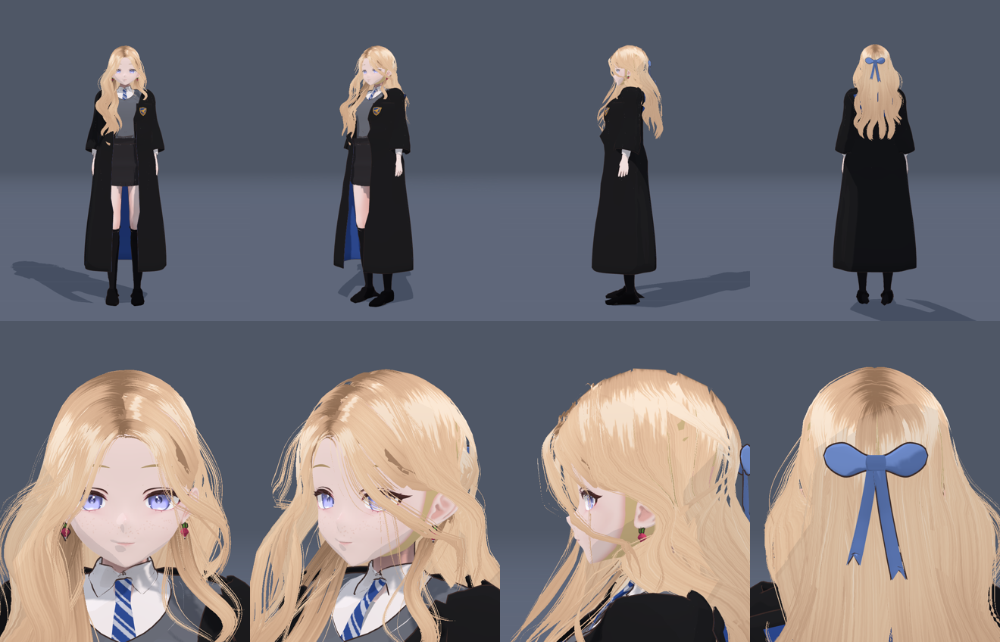
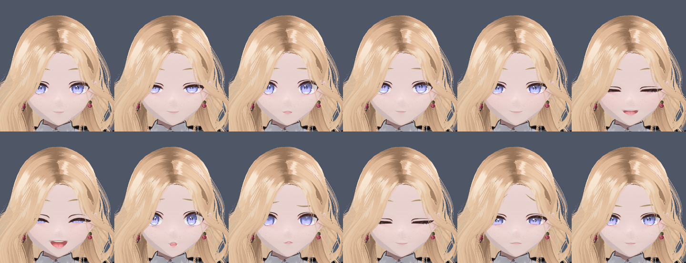
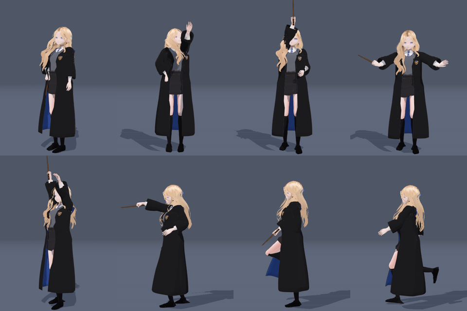
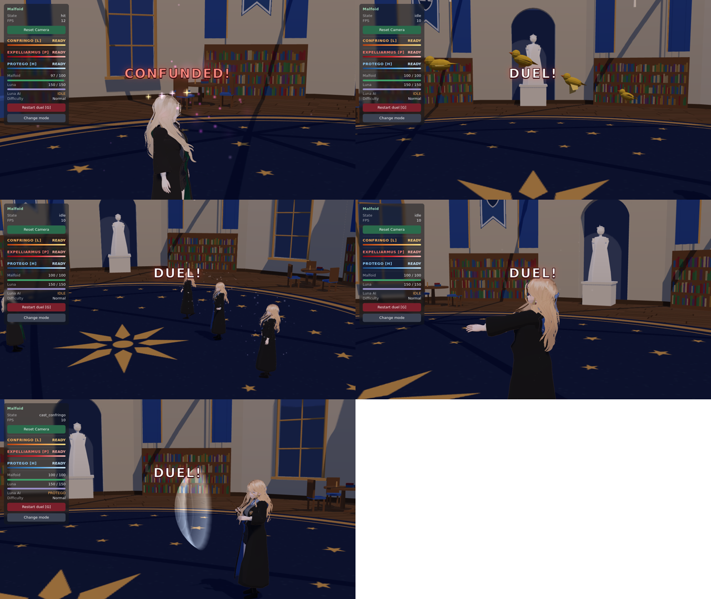
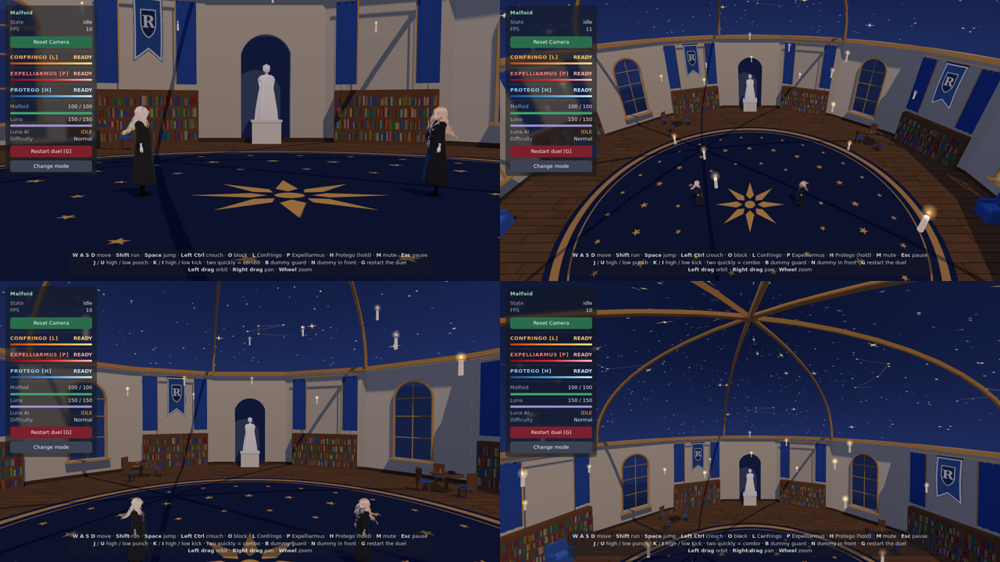
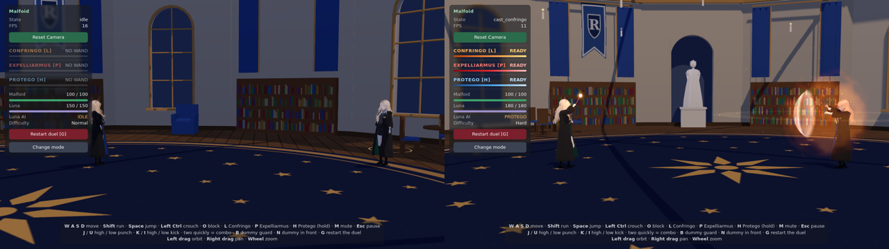

# Luna Lovegood — implementation and validation report

Luna is the fourth opponent: a Ravenclaw built as an illusion-and-disruption fighter, not a
damage dealer ([design](DESIGN.md)). She uses the same purchased assets and pipeline as the
others. Every screenshot here is from the real Three.js viewer (headless Chromium, SwiftShader),
not a Blender render. Her character and facial atlases stay local (`/Luna/` in `.gitignore`).

## Build

- `make luna` (`MF_CHAR=luna`) builds `build/luna.blend` and `public/models/luna.glb` (19.4 MB)
  + `.json`. Her values are in her profile in `tools/blender/malfoid/character.py`.
- **The others are untouched:** after the pipeline changes, Malfoid, Ginny, Cho and Susan
  rebuilt **byte-identical** (GLB and JSON, sha256). Adding her `protego` clip later left her
  other 38 clips identical.
- **Robe check** (`tools/qa/robe_folds.py`, which now finds her armature and her clips): **0 %
  folded area and 0 crossed vertices** for every clip.

## Appearance

- **Hair:** pale golden blonde, long, full and wavy, half-up where her braids meet, with a dusty
  blue ribbon bow (#7897D6).
  - The ramp is built from the atlases' drawn hair: a warm peach-gold, hue about 28°, saturation
    about 0.3. The paler #E8D7B6 swatch doesn't match the art, and a first ramp at hue 40° read
    yellow.
  - It's twice as saturated as Malfoid's platinum, so the two never read alike.
  - The two loose braids aren't modelled: the half-up gather stands in for where they meet.
- **Eyes:** lavender-blue, from the pack's blue-grey iris nudged towards violet. A first pass
  was too saturated once toon-shaded.
- **Face:** light freckles, pale brows, the base face as authored. Her resting face is dreamy:
  lids lowered a touch, outer brows raised, a faint smile.
- **Radish earrings:** a new style in `earrings.py`: a gold hook, three leaves, and a pink-red
  root tapering to a white tip, about 2.5 cm. A first pass at 1.3 cm read as a dark dot, the toon
  outline swallowing it.
- **Uniform:** Ravenclaw navy lining, blue-and-silver tie, grey vest, and the Ravenclaw crest
  painter with her own output.

## Expressions

`LUNA_FACES` in `src/character/faces.ts`, from her facial atlas:

- neutral, dreamy, curious, thoughtful, pleased, amused;
- excited, surprised, confused, serene, sad, determined;
- pain (in combat).

`LUNA_TALK` is her speaking mouth. "Excited" is built from the open smile; the pack's `Excited`
key opened the mouth into a round shout.

## Animation

Her own clips (`combat.EXTRA_CLIPS`, in her model only):

| Clip | What it does |
|---|---|
| `luna_idle` | A slow, dreamy sway, the head tilted and wandering, the wand dangling. |
| `distracted` | The wand lowered; she gazes up and follows something drifting by, the left hand reaching up. Lower, the hand read as a hand to her mouth. |
| `cast_illusio` | The wand draws a circle overhead, then her arms open down and forward as the copies appear (release 0.55 s). Level arms read as a T-pose. |
| `cast_oppugno` | The wand raised high, then flung forward as the birds leave (release 0.42 s). |
| `luna_skip` | Her skip in place of a run (1.66 m/s authored, played at 2.1 m/s): 70 % of the run's stride, knees higher. At full stride it read as a lunge. |

She also has Cho's `cast_quick` (Confundo), the side-step and the dodges, and the `protego` pose.

## Her kit

From top left:
- Confundo's stars round Malfoid's head;
- Oppugno's birds;
- Illusio: three Lunas, one real;
- distracted;
- her Protego meeting a Confringo.

| | Effect | Tuning |
|---|---|---|
| **Confundo** | A lilac bolt: 3 damage and a flinch. A hit **reverses Malfoid's directions** (W/S, A/D, running included) for 2 / 2.5 / 3 s by level. Attacks, guard and spells are unaffected. Stars circle her head and CONFUNDED! shows. A block stops it. | `spells/Confundo.ts` (8 s cooldown, 15 m/s) |
| **Expelliarmus** | Ginny's disarm, alternated with Confundo, and fired into Malfoid's own cast. | `spells/Expelliarmus.ts` |
| **Oppugno** | 4 / 5 / 6 yellow birds (about 24 cm). Each hits for 3 with a flinch, one after another. They home in at a limited turn rate; close in, each commits to a dive. A guard takes each as chip damage, walls stop them, Protego pops them, and a perfect Protego sends one back at Luna. | `spells/Oppugno.ts` (10 s cooldown) |
| **Illusio** | 2 / 2 / 3 copies for 8 / 9 / 10 s. She's shuffled among them as they appear. Any hit pops a copy, and only that copy: a spell that strikes one harms no one else, Luna included (on request). Walking into one pops it, and hitting Luna dispels them all. | `combat/Illusio.ts` (14 s cooldown) |
| **Protego** | Added on request: her shield against a spell she sees cast at her, at 25 / 35 / 45 % by level, sometimes timed to reflect (5 / 10 / 15 %). | `Protego.ts` |

**Fair tells for Illusio:**
- copies cast no shadow (Luna has 23 shadow-casting meshes, a copy none);
- they mimic her casts a beat late, with no bolt and no wand glow;
- only she blocks, shields, gets hit, or acts on her own;
- the duel camera frames the middle of the group, so it doesn't give her away.

**Why the birds needed tuning** (logic test, a target at 6 m):

| What Malfoid does | Birds that hit (of 5) |
|---|---|
| Stands still | 5, about 0.9-1.3 s after the cast |
| Steps aside too early | 5 (they adjust) |
| Steps aside as they dive | 2 |
| Sprints across their path | 0 |

The first versions either circled her forever (a fixed turn rate is a homing missile's orbit) or
could never be dodged (a turn rate that kept sharpening). The fix: a committed dive close in,
and the sharpening starts over after each dive.

**Why the copies needed fixing:** cloned skinned meshes got a skeleton each (about 26 bone
textures and updates per copy). Re-binding them to one shared skeleton per copy brought three
copies down from about +78 textures to +8.

## Her AI

A **chaotic style** in the shared `FighterAI`. Ginny, Cho and Susan don't have it. Randomness
shapes her decisions, never her attacks' tells.

- **Roaming:** she skips to spots on a ring round Malfoid (kept inside the arena), circles, or
  stops and stares. She thinks at irregular intervals (her reaction time × 0.6–2.4).
- **Bursts and pauses:** bursts of 2–4 quick actions, then an inexplicable pause.
- **Distracted:** when nothing presses her (Malfoid not attacking, casting, rushing or close, and
  no recent hits), she sometimes gazes at nothing for 1.2–2.6 s. She reads, guards and answers
  nothing until it ends or she's hit: a fair opening.
- **Opportunism:**
  - Confundo into a rush or an attack.
  - Expelliarmus into Malfoid's cast.
  - Illusio when hurt or crowded.
  - Oppugno at mid range.
- **Crowded:** she escapes, with a step back or a skip off across the room.
- **Her chosen spells:** she sees each through. If she had to turn first, she casts it once
  turned, instead of rerolling: rerolling made her lose most casts while skipping.

Her escape and the arena check came from playtests: in the round room she skipped into the
carpet's edge and was cornered.

## Arena: the Ravenclaw common room

A round tower room at night, generated in code (`src/scene/ravenclaw/`):
- arched windows onto a starry sky and the mountains;
- blue silks and eagle banners;
- a dome painted with stars, ribbed in bronze, with candles floating under it;
- bookcases, tables and chairs, blue armchairs;
- Rowena Ravenclaw's marble statue in a niche facing the duel camera;
- the midnight-blue carpet with bronze stars in the middle.

Earlier versions read wrong in two ways, fixed: the window glass was too opaque to show the night
outside, and the walls read near white.

- **Cost:** 99 draw calls and 360k triangles in the duel view. Copies add about 44 draw calls each
  while they're out.
- **The floor (fixed on request):** the fighters walk the whole room up to the bookcases, round
  the tables, armchairs and statue. At first the carpet's edge was the limit, which kept a
  dropped wand out of reach.
- **Dropped wands:** in every finite arena a knocked-away wand now comes to rest where a fighter
  can reach it.

Left: a wand knocked out past the carpet, then picked up. Right: Luna's Protego.

## Validation

| Check | Result |
|---|---|
| `npm test` | 112/112 (new `tests/luna.test.ts`: Confundo, the flock, copies, a Confringo at a copy leaving Luna untouched, her distraction, spell choice, roaming, escape, Protego) |
| Confundo with real keys | W moved Malfoid away from the camera (Δz −0.42); confused, towards it (+0.27); afterwards normal again |
| Illusio | copies have no shadows; a Confringo at a copy with Luna 0.8 m away popped only it (Luna 150 → 150); hitting Luna dispelled them all |
| Oppugno | a string of hits; GPU flat over repeated summons |
| The room | Malfoid walks past the carpet; a table pushes her out to its edge; the wall stops her at 11.82 m; a wand knocked at a table landed outside it and was picked up |
| GPU across all four arenas and opponents (with summons) | flat at 246 / 94 / 59 (geometries / textures / programs) |
| Combos, Confringo checks | 8/8, all pass |
| Malfoid, Ginny, Cho, Susan GLB/JSON | byte-identical |

### Playtests

A scripted Malfoid (FighterAI with Confringo) against Luna's real AI, in her arena, up to 180 s of
game time. The bot isn't affected by Confundo's reversed controls and always knows the real
Luna, so a human player will find her harder.

| Level | Winner | HP left | Time | Luna's casts | Malfoid confused | Bird hits | Confringos drawn by copies | Luna's Protego | Distracted |
|---|---|---|---|---|---|---|---|---|---|
| Normal | the bot (Malfoid) | 49 | 86 s | 18 (Confundo 5, Expelliarmus 6, Oppugno 3, Illusio 4) | 11.7 s | 5 | 1 | – | 2 x |
| Normal | the bot | 55 | 52 s | 15 | 2.5 s | 7 | 2 | – | 2 x |
| Hard | **Luna** | 52 | 130 s | 28 (Confundo 7, Expelliarmus 7, Oppugno 5, Illusio 9) | 15.9 s | 5 | 7 | 2 reflected | 3 x |
| Hard | the bot | 25 | 77 s | 14 | 8.6 s | 4 | 4 | 1 reflected | 1 x |

Before the tuning she lost at Normal in 45 s with the bot on 80 HP. She went 13 s without
casting, because turning to cast then rerolling the choice lost most of her spells. In her room
she got cornered against the carpet's edge.

## Known limitations

- **Her reward:** Illusio for Malfoid isn't built yet (like Susan's Episkey).
- **Voice lines:** she has none yet; her duel goes straight to ROUND 1.
- **Hair:** the two loose braids aren't modelled.
- **Statue:** Rowena's statue is simple shapes.
- **Copies cost:** about 44 draw calls each while out, outlines included, so they look like her.
- **Untested:** real-GPU frame rate and real-time feel; everything ran headless.
