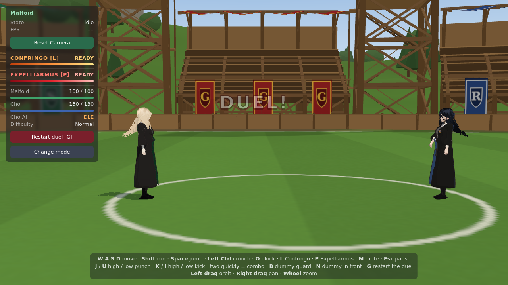
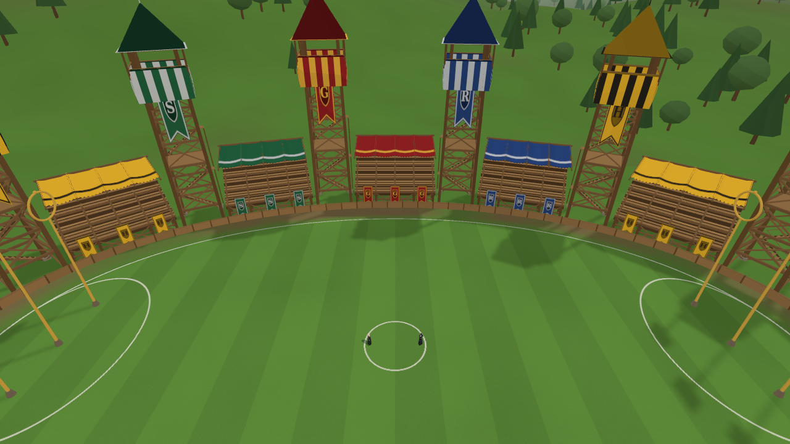
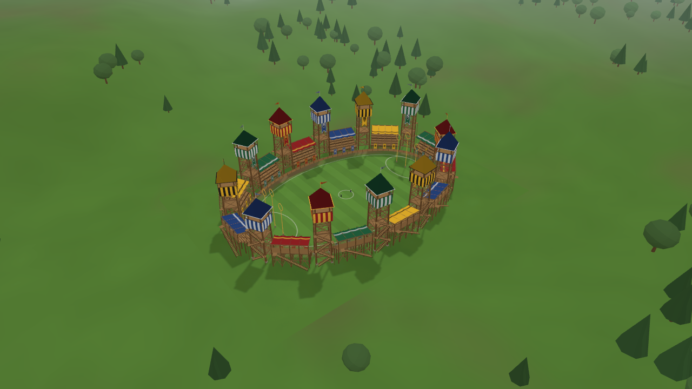
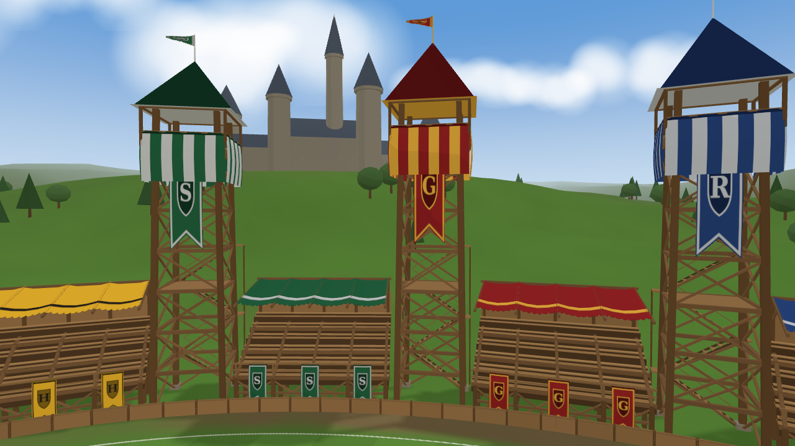
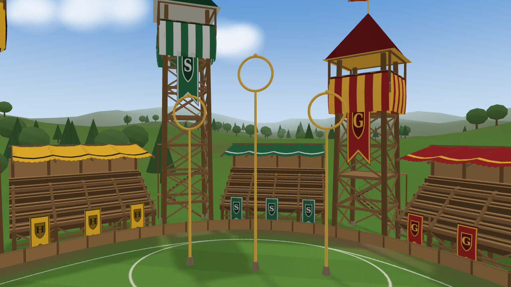
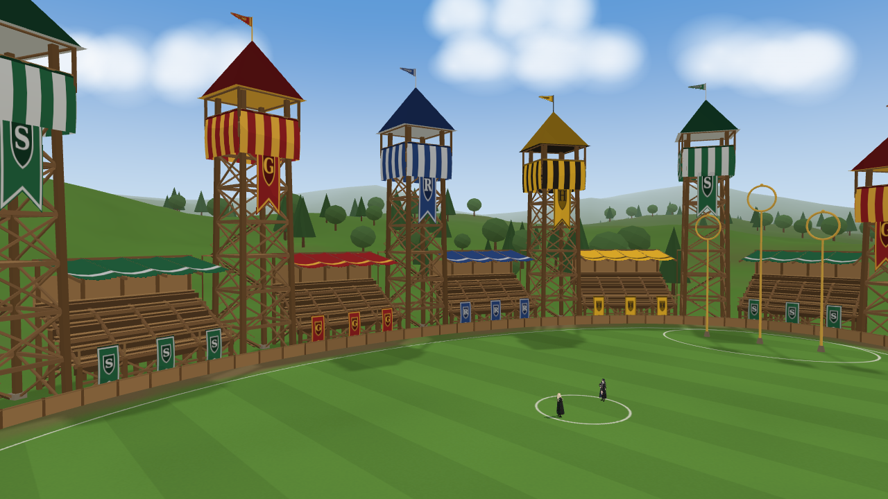
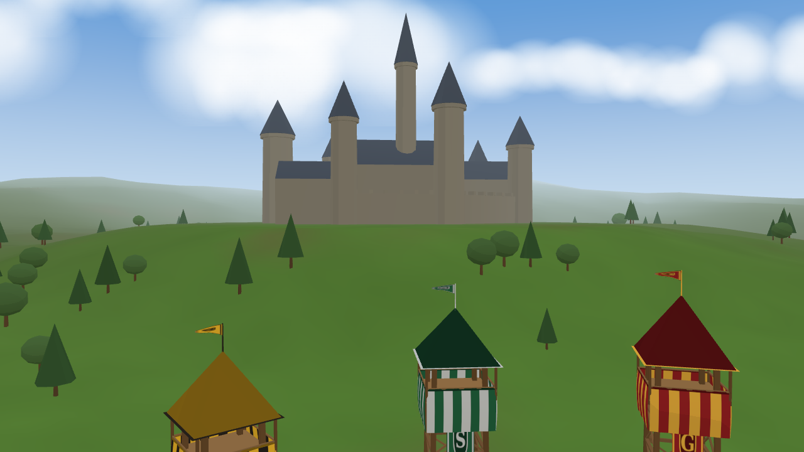
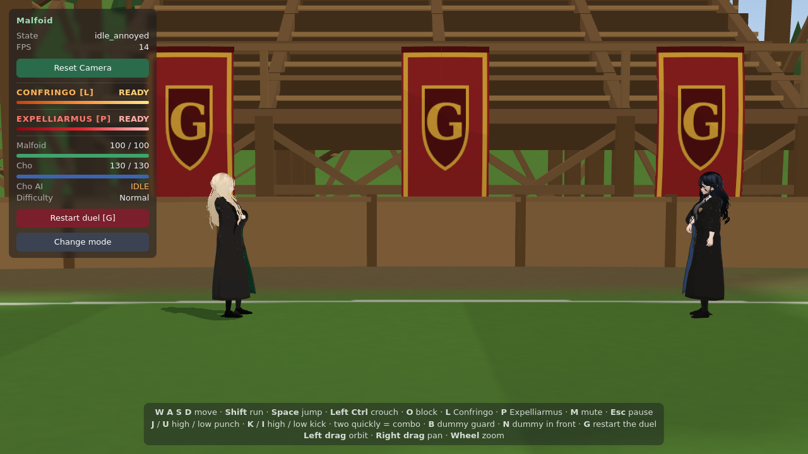
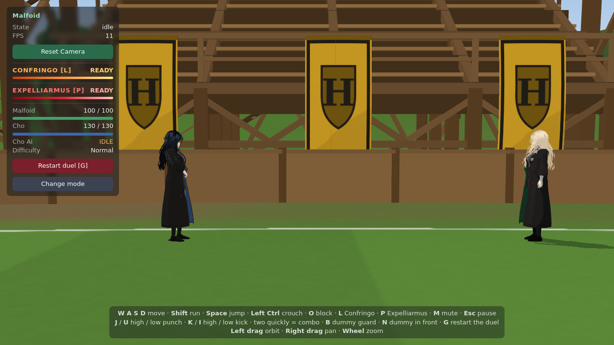
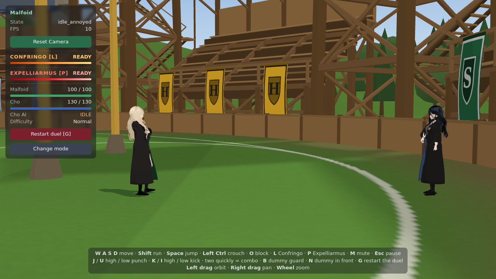

# Quidditch Pitch — the second arena (Cho's)

A Hogwarts Quidditch stadium for the duel against Cho Chang, generated entirely in code: no
model files, no downloaded assets. Unlike the endless Forbidden Woods it is **finite**: the
fighters stay inside the oval at the foot of the stands. Every screenshot is from the real
viewer (headless Chromium).

## What is built

| | |
|---|---|
|  |  |
|  |  |
|  |  |

- **The field** (`textures.ts`, one generated texture): an 80 x 48 m oval of grass with mown
  stripes and colour variation, chalk lines (the field's edge, the centre circle, the scoring
  areas round the hoops), a worn earth apron under the stands. **The shadows of the towers,
  stands and hoops are baked into it** at start-up (a ray towards the sun from each 25 cm cell),
  so the stadium shades the grass without a giant real-time shadow map; the fighters keep their
  own sharp moving shadow.
- **Twelve house towers** (`structures.ts`), three per house: a tapering four-post timber frame
  with ring beams and cross braces every 3.2 m, a landing, a zigzag stair up the back, a
  spectator box with an overhanging floor and knee braces, striped house drapery hanging from
  its rail, a pointed roof in the house colour with gold or silver eave trim, a finial and a
  pennant, and a long house banner down its front.
- **Grandstands** between the towers: six tiers of treads, risers and benches on a post-and-beam
  frame with cross braces, a front rail with three house banners, cantilevered rafters carrying
  a scalloped house canopy, a boarded back and a stair. Straight stands on a curved oval are
  pushed out by their own sag, so none crosses the boundary.
- **Six goal hoops**: three per end (12.5 / 15.5 / 12.5 m), brass posts on stone footings.
- **A low timber barrier** at the foot of the stands marks the edge of the play area.
- **The landscape** (`landscape.ts`, scenery only): rolling hills on a 640 m disc, 420 trees in
  clumps, the castle on a plateau (keep, great hall, round towers with slate cones, the
  astronomy tower, crenellated walls), a gradient sky dome, clouds, light haze.
- **House colours**: Gryffindor red / gold, Ravenclaw blue / silver, Hufflepuff yellow / black,
  Slytherin green / silver, in one generated cloth atlas (swallowtail banners with a shield and
  the house initial, striped drapery, canopy cloth).
- **Daylight**: a warm sun (the same direction as the baked shadows), sky / grass hemisphere
  fill, a soft rim light.

**Cost**: 5 meshes (structures, cloth, ground, land, sky) plus the cloud sprites, ~101 k
triangles, built once at load (the whole page loads in ~1.5-2.5 s headless); the duel frame is
~80 draw calls with both characters. Nothing is rebuilt per frame (`update` is empty).

**Libraries**: none added. Three.js's own `BufferGeometryUtils.mergeGeometries`, box / cylinder /
cone / torus / extrude geometries, and the forest's noise helpers.

## Arenas in the game

`src/scene/arena.ts` is what a duel needs from an arena: the spawn, the light, `resolve`
(collision), `fillSolids` (spell solids), the camera limit, a per-frame update. The Forbidden
Woods is adapted to it unchanged (`ForestArena.ts`); `PitchArena.ts` is the stadium. Each
opponent's definition names her arena: Ginny the woods, Cho the pitch; training keeps the studio.

## Boundaries

- **Fighters**: kept inside an oval 0.8 m inside the foot of the stands (just inside the
  barrier), pushed back along it (they slide along the edge); the hoop posts are solid circles.
  Checked: running at the stands stops at the edge; a hard knockback towards them stays inside;
  Cho's dodge towards the wall stays inside.
- **Spells**: 96 thin boxes along the barrier and the hoop posts are the spell solids: a
  Confringo fired at the stands bursts on the barrier (checked), Ventus breaks on it.
- **Camera**: kept inside the stands' oval. A duel near the edge is watched from the open side
  (the side-on view flips when its side would be in the stands); anything left is pulled in
  towards the fighters.

| | | |
|---|---|---|
|  |  |  |

- **Cho's AI**: tracks Malfoid anywhere on the pitch (her detection range was 14 m: on an 80 m
  field she stood still once Malfoid walked away); backing into the barrier she slips away along
  it instead of pressing into it (Ginny's AI unchanged). A duel restarted with G starts at the
  centre again (in the woods it still restarts where Malfoid stands).

## Validation

| Check | Result |
|---|---|
| `npm test` | 66 / 66 |
| Combos, Confringo (20 direct, held L once, cooldown frozen while paused, miss at 25 m, effects clean up) | 8 / 8, all pass |
| Ginny's duel | in the Forbidden Woods, her AI acts |
| Two 80 s scripted duels against Cho on the pitch (Normal mixed, Hard Confringo spam) | both fight (HP falls on both sides), never stuck |
| Cho chased into the long side's barrier | 54 % of the time at the wall, never stuck, never outside |
| Cho chased at the round end | slips away from the end, never stuck (knocked out at 18.8 s) |
| Camera at the far stands, the near stands, by the hoops | always on the pitch, both fighters framed |

## Tunables (`src/scene/pitch/config.ts`)

Field half length / width, apron, boundary margin; grass colour, stripe width and contrast,
variation; tower count, width, box height and jitter; stand tiers, depth, rise, base height,
post spacing, canopy on/off, banners per stand, tower banners; hoop distance, spacing, heights,
radius; land radius, hill height, tree count, castle bearing / distance / scale, clouds; sun
colour, intensity and direction; sky and haze; baked shadow strength and cell size. The house
colours are `HOUSES` in the same file.

## Still rough

- **Close up, the stands are boxes and planks**: no carved detail, no spectators.
- **The castle** is a simple silhouette at 280 m: recognisable, not detailed.
- **The baked shadows** don't move, and the fighters walking through them are still lit by the
  sun (the shadows sit mostly near the stands, away from the fight).
- **Real frame rate** on a GPU can't be measured here (headless runs on a software renderer).

## Next most valuable improvement

Spectators in the stands (cheap instanced silhouettes in house colours) would make the stadium
feel alive at the gameplay camera, where the lower stands fill the background.
