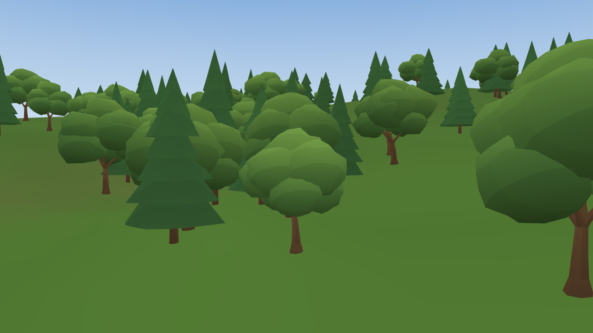
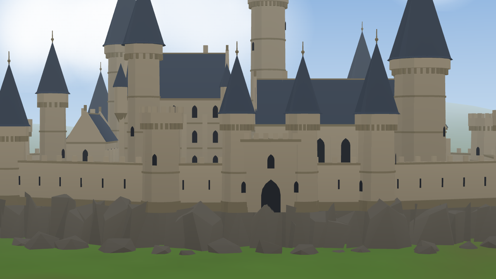
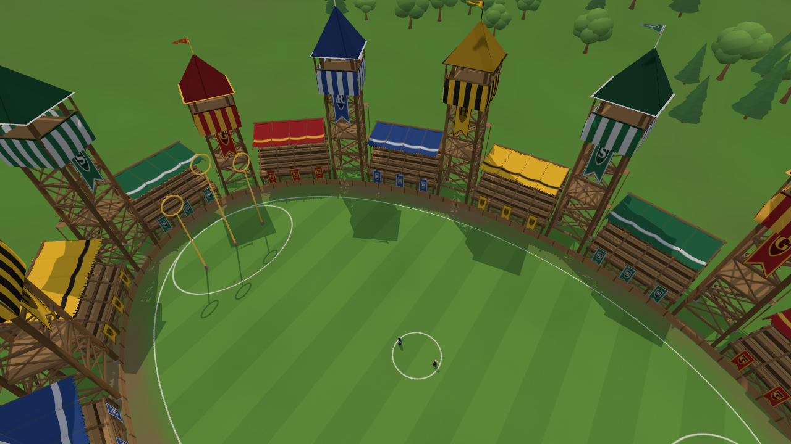
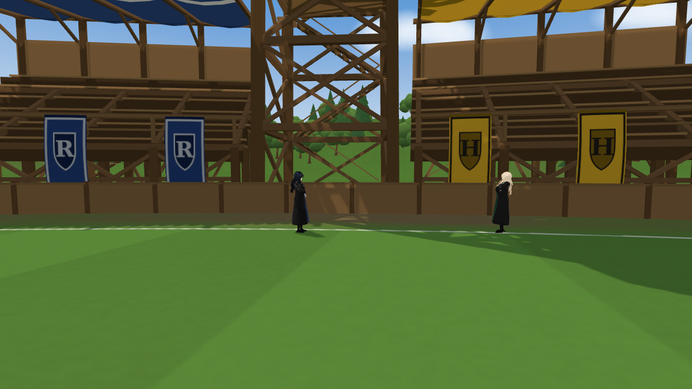
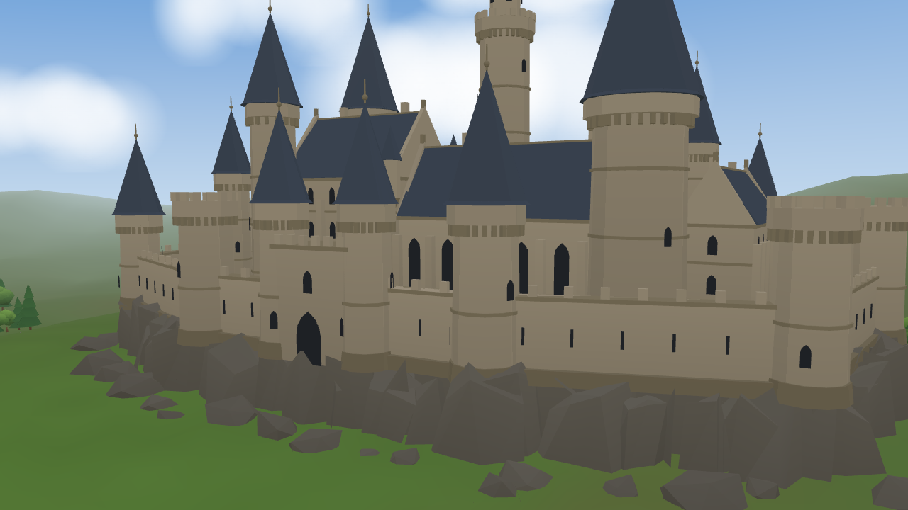
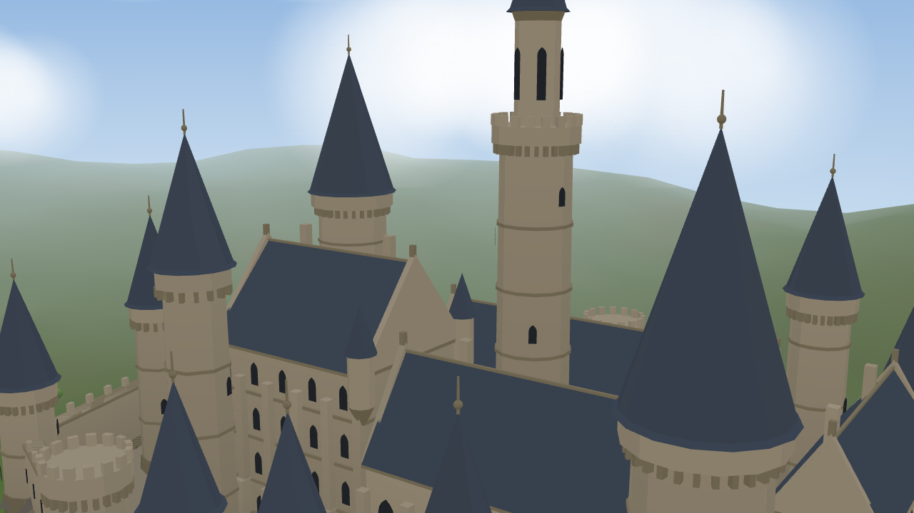

# Quidditch Pitch — the second arena (Cho's)

A Hogwarts Quidditch stadium for the duel against Cho Chang, generated entirely in code: no
model files, no downloaded assets. Unlike the endless Forbidden Woods it is **finite**: the
fighters stay inside the oval at the foot of the stands. Every screenshot is from the real
viewer (headless Chromium).

## What is built

| | |
|---|---|
|  |  |
|  |  |
|  |  |

- **The field** (`textures.ts`, one generated texture): an 80 x 48 m oval of grass with mown
  stripes and colour variation, chalk lines (the field's edge, the centre circle, the scoring
  areas round the hoops), a worn earth apron under the stands.
- **Shadows**: one real sun shadow (120 m square, 4096 px) over the whole stadium: the towers,
  stands, cloth and hoops shade the grass, each other and the fighters (see Polish below).
- **Twelve house towers** (`structures.ts`), three per house: a tapering four-post timber frame
  with ring beams and cross braces every 3.2 m, a landing, a zigzag stair up the back, a
  spectator box with an overhanging floor and knee braces, striped house drapery hanging from
  its rail, a pointed roof in the house colour with gold or silver eave trim, a finial and a
  pennant, and a long house banner down its front.
- **Grandstands** between the towers: six tiers of treads, risers and benches on a post-and-beam
  frame with cross braces, a front rail with three house banners, cantilevered rafters carrying
  a scalloped house canopy, a boarded back and a stair. Straight stands on a curved oval are
  pushed out by their own sag, so none crosses the boundary.
- **Six goal hoops**: three per end (12.5 / 15.5 / 12.5 m), brass posts on stone footings.
- **A low timber barrier** at the foot of the stands marks the edge of the play area.
- **The landscape** (`landscape.ts`, scenery only): rolling hills on a 640 m disc, 600 trees in
  clumps (`trees.ts`), the castle on its crag (`castle.ts`), a gradient sky dome, clouds beyond
  the castle, light haze.
- **House colours**: Gryffindor red / gold, Ravenclaw blue / silver, Hufflepuff yellow / black,
  Slytherin green / silver, in one generated cloth atlas (swallowtail banners with a shield and
  the house initial, striped drapery, canopy cloth).
- **Daylight**: a warm sun casting the stadium's shadow, sky / grass hemisphere fill, a soft
  rim light.

**Cost**: 6 meshes (structures, cloth, castle, ground, land, sky), the instanced trees and the
cloud sprites, built once at load. The wide view is 104 draw calls and ~715 k triangles with the
shadow pass and both characters. Nothing is rebuilt per frame (`update` is empty).

**Libraries**: none added. Three.js's own `BufferGeometryUtils.mergeGeometries`, box / cylinder /
cone / torus / extrude geometries, and the forest's noise helpers.

## Polish: trees, shadows, castle

| | |
|---|---|
|  |  |
|  |  |
|  |  |

- **Trees** (`trees.ts`, were single cones and balls): conifers of stacked drooping tiers with
  ragged rims; broadleaves with a short trunk and a full crown of 9 smooth-shaded clusters
  (top, middle and a lower ring). Three variants of each, three levels of detail by distance
  (under 150 m, to 230 m, beyond), instanced (18 meshes for 600 trees), each tree turned,
  scaled and tinted. About 291 k instanced triangles.
- **Shadows** (were baked into the ground texture: faint, blobby, and the stands cast none on
  each other; the default 3 m follow shadow round Malfoid left Cho without one away from her):
  an arena's look may now name a fixed shadow (`EnvironmentLook.shadow`: centre, half size, map
  size, biases); `SceneManager.setShadow` switches between it and the default follow shadow.
  The pitch uses one 120 m, 4096 px sun shadow; structures and house cloth (with its alpha
  cut-outs) cast and receive it. The bake, its ray test and the occluder boxes are gone. No
  acne at the duel camera; the woods are unchanged.
- **Castle** (`castle.ts`, was boxes and plain cylinders): a gothic castle on a rock podium (rock
  columns with flat-shaded facets round a solid core, scree at their foot). Five stone ranges
  with plinths, string courses, buttresses, pointed windows (tall ones in the great hall), steep
  slate roofs between stone gables, ridge cresting, chimneys, and corner bartizans on the keep.
  Six towers (round and octagonal) with string courses, windows climbing round the shaft, a
  corbelled gallery and a tall cone with a finial; the tallest carries a lantern stage. A
  crenellated curtain wall with arrow slits and a tower at every corner, and a gatehouse with
  two drum towers. All values in `CASTLE` (podium and wall heights, merlon pitch, cone ratio,
  colours) and the layout tables at the top of the file. It is its own mesh outside the
  shadow (no shadow pass): 22.6 k triangles, one draw call. The clouds now sit beyond it
  (430-580 m), so none drifts across the spires.

## Arenas in the game

`src/scene/arena.ts` is what a duel needs from an arena: the spawn, the light, `resolve`
(collision), `fillSolids` (spell solids), the camera limit, a per-frame update. The Forbidden
Woods is adapted to it unchanged (`ForestArena.ts`); `PitchArena.ts` is the stadium. Each
opponent's definition names her arena: Ginny the woods, Cho the pitch; training keeps the studio.

## Boundaries

- **Fighters**: kept inside an oval 0.8 m inside the foot of the stands (just inside the
  barrier), pushed back along it (they slide along the edge); the hoop posts are solid circles.
  Checked: running at the stands stops at the edge; a hard knockback towards them stays inside;
  Cho's dodge towards the wall stays inside.
- **Spells**: 96 thin boxes along the barrier and the hoop posts are the spell solids: a
  Confringo fired at the stands bursts on the barrier (checked), Ventus breaks on it.
- **Camera**: kept inside the stands' oval. A duel near the edge is watched from the open side
  (the side-on view flips when its side would be in the stands); anything left is pulled in
  towards the fighters.

| | | |
|---|---|---|
|  |  |  |

- **Cho's AI**: tracks Malfoid anywhere on the pitch (her detection range was 14 m: on an 80 m
  field she stood still once Malfoid walked away); backing into the barrier she slips away along
  it instead of pressing into it (Ginny's AI unchanged). A duel restarted with G starts at the
  centre again (in the woods it still restarts where Malfoid stands).

## Validation

| Check | Result |
|---|---|
| `npm test` | 66 / 66 |
| Combos, Confringo (20 direct, held L once, cooldown frozen while paused, miss at 25 m, effects clean up) | 8 / 8, all pass |
| Ginny's duel | in the Forbidden Woods, her AI acts |
| Two 80 s scripted duels against Cho on the pitch (Normal mixed, Hard Confringo spam) | both fight (HP falls on both sides), never stuck |
| Cho chased into the long side's barrier | 54 % of the time at the wall, never stuck, never outside |
| Cho chased at the round end | slips away from the end, never stuck (knocked out at 18.8 s) |
| Camera at the far stands, the near stands, by the hoops | always on the pitch, both fighters framed |

## Tunables (`src/scene/pitch/config.ts`)

Field half length / width, apron, boundary margin; grass colour, stripe width and contrast,
variation; tower count, width, box height and jitter; stand tiers, depth, rise, base height,
post spacing, canopy on/off, banners per stand, tower banners; hoop distance, spacing, heights,
radius; land radius, hill height, tree count, castle bearing / distance / scale, clouds; sun
colour, intensity and direction; the stadium shadow's half size, map size and biases; sky and
haze. The house colours are `HOUSES` in the same file; trees in `TREE` (`trees.ts`), the castle in
`CASTLE` (`castle.ts`).

## Still rough

- **Close up, the stands are boxes and planks**: no carved detail. No spectators, by design.
- **The castle** is built to be seen from the pitch: its back is as plain as its front, the
  windows are flat dark shapes, and the crag's rock columns repeat a little at a long lens.
- **The stadium shadow** is one 4096 px map over 120 m (about 3 cm a texel): sharp enough at the
  duel camera, a little soft on thin timbers seen up close; the castle and the land outside the
  stadium take no shadow.
- **Real frame rate** on a GPU can't be measured here (headless runs on a software renderer).

## Next most valuable improvement

A real-GPU check of the frame time with the 4096 px stadium shadow (the one cost added here
that the headless renderer can't measure); if it is heavy, 2048 px over the field alone is the
fallback (`shadowMapSize`, `shadowHalfSize`).
