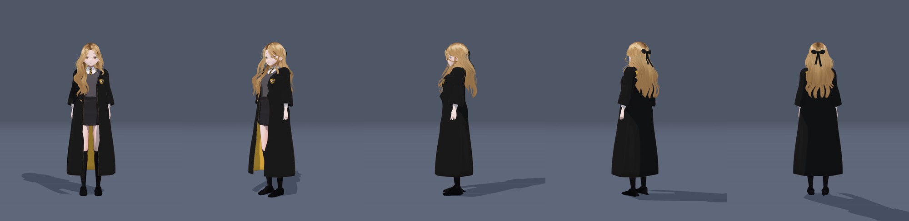
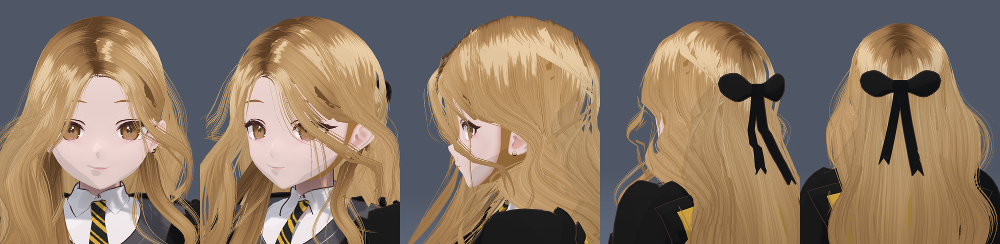
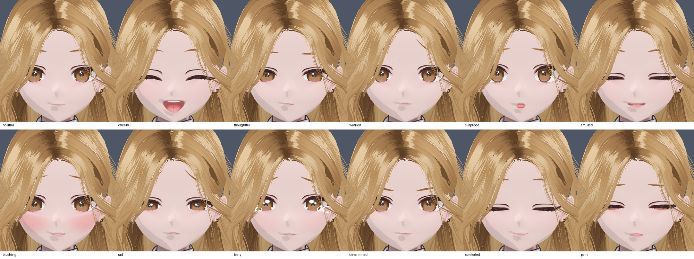
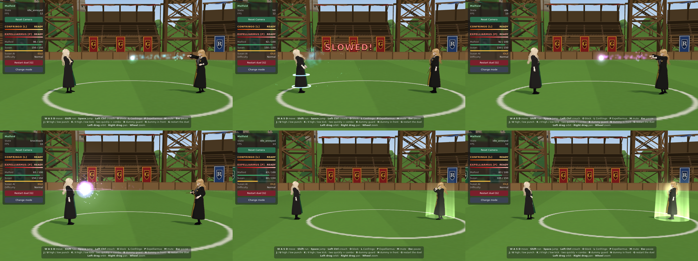
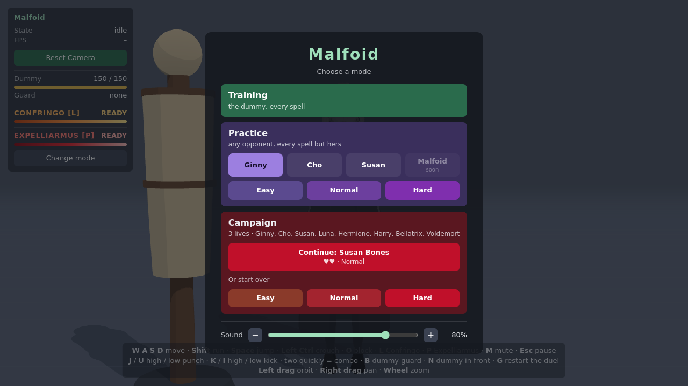
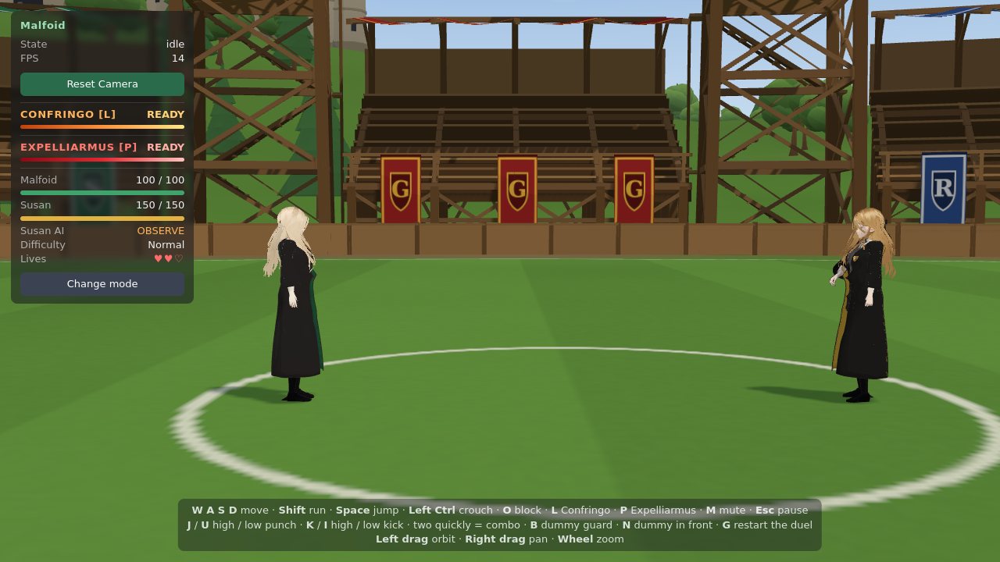

# Susan Bones — implementation and validation report

Susan is the third opponent, the roster's only Hufflepuff: a defensive duellist built from the
same purchased assets and pipeline as Malfoid, Ginny and Cho ([design](DESIGN.md)). Every
screenshot here is from the real Three.js viewer (headless Chromium, SwiftShader), not a
Blender render. Her character atlas and facial atlas stay local (`/Susan/` in `.gitignore`).

## Build

- `make susan` (`MF_CHAR=susan`) builds `build/susan.blend` and `public/models/susan.glb`
  (18.9 MB) + `.json`, in about 40 s. Her values live in her profile in
  `tools/blender/malfoid/character.py`.
- **Malfoid, Ginny and Cho are untouched:** after every pipeline change, their GLB and JSON
  rebuilt **byte-identical** to the committed files (sha256).
- **Robe check** (`tools/qa/robe_folds.py`, which now finds Susan's armature and checks her
  clips): **0 % folded area and 0 crossed vertices** for every movement clip, `susan_idle`,
  `episkey`, `cast_ventus` and `strafe`.

## Appearance

- **Hair:** the purchased Bell_Hair_01 cards, reshaped as for Ginny: long, wavy and full (not
  slimmed), with an off-centre part, half-up at the back. Recoloured honey blonde. The first
  ramp read marigold-orange once toon-shaded, so the ramp sits more tan than the #D8A65F swatch.
- **Bow:** Cho's ribbon geometry (knot, loops, V-cut tails that sway with the hair), in black.
  It is 1.2 x Cho's size, set by a new `ribbon_scale` profile key; Cho's bow is unchanged.
- **Eyes:** hazel brown, from the pack's brown iris art. A first pass was too orange.
- **Brows:** honey brown.
- **Lashes:** natural brown.
- **Skin:** fair with a gentle warm undertone.
- **Face:** the base face as authored (soft and round). Her resting face has a warm closed
  smile and relaxed lids.
- **Earrings:** small gold studs (`earrings.py`, new style `'stud'`).
- **Uniform:** black and gold tie, Hufflepuff-gold lining, and a painted badger crest
  (`tools/textures/make_crest_hufflepuff.py`). The crest has a gold upper-left field and black
  elsewhere, a gold pale, a cream badger head with its dark band, and a laurel. It reuses the
  Ravenclaw painter's shield and laurel.

## Expressions

`SUSAN_FACES` in `src/character/faces.ts` follows the atlas sheet:

- neutral, cheerful, thoughtful, worried, surprised, amused
- blushing, sad, teary, determined, **comforted** (her healing face), pain

`SUSAN_TALK` is her speaking mouth.

## Animation

She shares every move with the others. Her own clips (`combat.EXTRA_CLIPS`, built into her
model only):

- `susan_idle`: planted and patient, with the wand held ready and low.
- `episkey`: the wand touches her chest, her head bows, then her chest lifts at the end (1.5 s).

She also has Cho's `cast_quick` (used for Impedimenta), `cast_ventus` (used for Depulso) and
`strafe`, so her legs follow when she moves while facing Malfoid.

## Her kit

Top row: Impedimenta in flight; Malfoid slowed (rings, "SLOWED!"); Depulso. Bottom row:
Depulso's impact; Episkey being cast; Episkey taking effect (Susan 80 → 105 HP).

| | Effect | Tuning (file) |
|---|---|---|
| **Impedimenta** | Cold blue bolt, 4 damage and a flinch. The target is **slowed to 55 % for 2.5 s**: a slowed fighter's movement, strikes, casts and bolts run on scaled game time. A block stops it. | `spells/Impedimenta.ts` (6 s cooldown, 17 m/s) |
| **Depulso** | Violet bolt, 9 damage, a 6 m/s knockback, 7 m range | `spells/Depulso.ts` (8 s cooldown) |
| **Episkey** | Heals at the end of a 1.5 s cast. Any hit that gets through breaks it, and she keeps the charge. Never heals past full. 6 s between heals, 2 s after a broken cast. | `Episkey.ts`; amount and charges per level |
| **Hufflepuff Resolve** | A stagger becomes a flinch, a knockdown becomes a knockback, and she takes 60 % of the push. Damage is unchanged. | `FighterTarget.ts` (`HUFFLEPUFF_RESOLVE`) |

The effects are additive meshes and particles with no lights:

- **Impedimenta:** a cold blue bolt.
- **Depulso:** a violet bolt, bluer than Expelliarmus's crimson-pink so the two never read alike.
  An earlier pink version was too close, and its impact flare hid Malfoid; the burst is now small.
- **Slow:** two blue rings at the legs.
- **Episkey:** a green-gold column and a chest glow.

Effect pools are shared through the existing `ConfringoFx` / `SpellLook`.

Her spells borrow sounds until she has her own: Impedimenta uses Expelliarmus's, and Depulso uses
Ventus's. She has no voice lines yet, so her duel goes straight to the fight with no win lines.

## Her AI

The shared `FighterAI` gains an optional **defensive style** (`DefensiveStyle`). Ginny and Cho
don't have it.

- **Holding her ground:** she waits at mid range and walks in only when Malfoid is beyond 6.5 m.
  She doesn't step in while hurt.
- **Guarding:** she guards a lot and holds her guard. She **reads a spell being cast at her** and
  has her guard up when it arrives, so a spell lands as chip damage. She has no parry and no
  dodge.
- **Against a rush:** when Malfoid closes faster than 2.2 m/s, she casts Impedimenta. If Malfoid
  rushes into her reach, she may strike first.
- **When crowded or attacked:** she casts Depulso.
- **Hurt (below 60 %):**
  - she makes room with Depulso or a short run away (her back is open), then heals;
  - she backs off at most once every 5 s, so chased down she fights;
  - a hit breaks the heal.
- **Below half health:** a more determined face and a little more guarding.
- **Openings:** she punishes only an opening already in her reach. She doesn't walk after one.

| Level | HP | Episkey | Reactions (s) | Block | Spell guard | Rush → Impedimenta | Depulso |
|---|---|---|---|---|---|---|---|
| Easy | 120 | 2 x 20 | 0.25–0.45 | 50 % | 35 % | 40 % | 40 % |
| Normal | 150 | 2 x 25 | 0.16–0.30 | 65 % | 55 % | 60 % | 55 % |
| Hard | 190 | 3 x 30 | 0.10–0.20 | 78 % | 70 % | 75 % | 70 % |

Found and fixed while playtesting:

- **Melee-only guard:** she guarded only against melee, so Confringo after Confringo landed in
  full. She died in 26 s and never healed. The spell guard came from this.
- **Healing:** her backing-off to heal was a slow back-step that the next decision cut short
  after 0.4 s, and she even stepped back in. It is now Depulso or a short run, which isn't
  interrupted until she has room.
- **Chasing openings:** hurt, she still walked out to punish Malfoid's casts from range. That is
  removed for her style.

## In the game

- **Practice:** a Susan button. She fights on the Quidditch Pitch, which is open ground for her
  spells.
- **Campaign:** she is stage 3, after Cho. Beating her teaches nothing yet, because Malfoid's
  Episkey isn't built. After her, Luna is shown as coming soon.
- **HUD:** her bar is Hufflepuff gold. "SLOWED!" is announced when Impedimenta lands.

## Validation

| Check | Result |
|---|---|
| `npm test` | **75 / 75**; new `tests/susan.test.ts` (see below), campaign order updated |
| Malfoid / Ginny / Cho GLB + JSON | byte-identical |
| Robe folds (all clips, hers included) | 0 |
| 8 combos | 8 / 8 with the expected damage |
| Confringo | 20 direct, holding L casts once, cooldown frozen while paused, a miss ends at 25 m, effects clean up |
| GPU over 4 rounds of Impedimenta, Depulso and Episkey | 93 / 40 / 37 every round (geometries / textures / programs) |
| Campaign at stage 3 | "Continue: Susan Bones", pitch, Normal, 150 HP, 2 x 25 Episkey, her AI acts |
| Practice Ginny / Cho / Susan | each starts in her arena with her AI acting |
| Episkey trace (Normal, starting hurt) | Depulso to make room, heal 45 → 70; a Confringo breaks a heal (charge kept); heal 42 → 67 |

`tests/susan.test.ts` covers:

- **Impedimenta:** the slow and its timing, frozen while paused, stopped by a block, cleared by a
  new duel.
- **Depulso:** its range and knockback.
- **Resolve:** what it changes, and that the others are unchanged.
- **Episkey:** the heal, the break, the kept charge, the cap at full health, running out, and no
  wand.
- **AI:** holding her ground, Impedimenta at a rush, Depulso when crowded, the heal flow, and the
  spell guard.

**Duels against a scripted Malfoid** (Ginny's Normal AI in the player's place). These are single
runs at headless frame rates, so they are indicative only:

| Susan level / player style | Winner | Notes |
|---|---|---|
| Easy, mixed | Malfoid (68 HP left) | 26 s; Susan never got to heal (before the heal fix) |
| Normal, mixed | **Susan** (91 / 150 left) | 31 s; 8 guards, 1 heal |
| Normal, Confringo at range | **Susan** (57 / 150 left) | 50 s; 22 guards, Depulso 5 of 6, 1 heal |

The scripted player keeps attacking into her guard, which is exactly what she punishes. A human
who waits for her strikes and breaks her heals should do better. Normal may still be too hard.
The levers are `SUSAN_DIFFICULTY` in `src/combat/ai/difficulty.ts`: block, counter, spell
guard, Episkey amount, HP.

## Known limitations

- **Malfoid's Episkey** (the reward for beating her) is not built. The campaign reward is empty
  for now, as Protego's is for Cho.
- **No voice lines**, and her spell sounds are borrowed from Expelliarmus and Ventus.
- **Hair:**
  - she has no wispy fringe, only the pack's hairline with an off-centre part; after Cho's
    rejected fringe, none was added;
  - one pack strand falls across her right eye in the front view;
  - the pack's straight-cut card ends show as blocks at the temple in the side view;
  - the half-up is softer than drawn.
- **Robe:** it has no gold hood lining at the back (the shared robe has no hood).
- **Arena:** she fights on Cho's pitch. A Hufflepuff place (the greenhouses) would suit her.
- **Balance** is tuned only against a scripted player; Normal and Hard need human play.
- **Headless only:** the real frame rate and how the effects feel in motion are untested.
  Headless runs at 1–10 fps, so the AI was exercised in 0.1 s frames.
